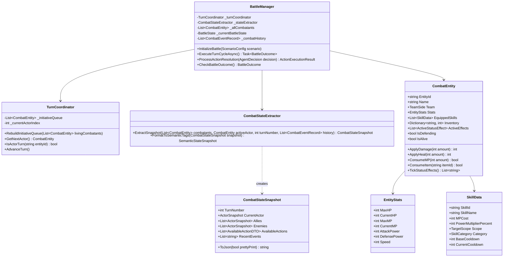

# Rencana Implementasi Terperinci: Core Combat Engine & State Extractor

**Modul:** Milestone 2 (Core Combat Engine & State Extractor)  
**Dokumen Induk:** [`master_implementation_plan.md`](file:///c:/Ginza/Github/Metodologi-Penelitian/implementation%20plan/master_implementation_plan.md)  
**Tujuan Utama:** Membangun fondasi lingkungan pertarungan RPG *turn-based* deterministik tanpa pengaruh visual/fisika, serta modul ekstraktor status medan laga yang menghasilkan representasi data murni (*snapshot*) untuk dikonsumsi oleh seluruh agen AI (HFSM, Pure LLM, Hybrid) dan sistem telemetri.

---

## 1. Filosofi Desain & Standar Teknis

1. **Deterministik Mutlak (Zero RNG in Core Experiment):**
   - Formula kalkulasi *damage*, *healing*, dan *speed order* tidak menggunakan *random number generator* (RNG) acak (misal: *critical hit chance* bernilai 0% atau menggunakan nilai ekspektasi tetap).
   - Hal ini memastikan bahwa perbedaan keputusan antar-agen murni berasal dari arsitektur penalaran AI ($X1$), pembatasan guardrail ($X2$), atau kompresi konteks ($X3$), bukan variasi keberuntungan dadu RNG.
2. **Pemisahan Logika & Tampilan (Strict Logic/View Decoupling):**
   - Logika pertarungan tidak bergantung pada MonoBehaviour `Update()`, sistem fisika, transform animasi, atau coroutine berbasis waktu nyata (`WaitForSeconds`).
   - Mendukung dua mode eksekusi:
     - **Mode Visual (Interactive):** Menghubungkan event ke HUD/UI Unity untuk demonstrasi visual dan perekaman video evaluasi manusia ($Y5$).
     - **Mode Headless (Fast-Forward):** Mengeksekusi satu pertarungan penuh dalam hitungan milidetik secara asinkron/loop sinkron untuk batch 720 runs ($M7$).
3. **Kekebalan Modifikasi State (*Immutability Guarantee*):**
   - Modul `CombatStateExtractor` menghasilkan objek POCO (*Plain Old C# Object*) yang terisolasi (*deep-cloned*). Jika agen AI (terutama prompt builder atau validator) memodifikasi nilai di dalam snapshot, status asli karakter di medan laga tidak akan terpengaruh.

---

## 2. Arsitektur Kelas & Struktur Tipe Data



---

## 3. Rincian Implementasi Komponen Core Combat

### 3.1 Siklus Hidup Mesin Pertarungan (`BattleManager.cs`)
Pertarungan dikelola oleh mesin status (*Finite State Machine*) internal `BattleState`:

```
[Uninitialized] 
       │ InitializeBattle(ScenarioConfig)
       ▼
[RoundStart] ──► RebuildInitiativeQueue(Speed)
       │
       ▼
[TurnStart] ──► Ambil CurrentActor, kurangi Cooldown, proses Tick Status Effect
       │
       ▼
[StateExtraction] ──► CombatStateExtractor.ExtractSnapshot()
       │
       ▼
[WaitingForDecision] ──► Panggil IAgentController.DecideActionAsync(snapshot)
       │
       ▼
[ValidatingAction] ──► Verifikasi integritas aksi (Guardrail jika Hybrid, langsung jika Pure)
       │
       ▼
[ResolvingAction] ──► Hitung Damage/Heal, kurangi Resource, catat Event Log
       │
       ▼
[CheckingOutcome] ──► Apakah seluruh Tim Musuh atau Tim Sekutu telah gugur?
       ├── Tidak: AdvanceTurn() ──► Lanjut ke [TurnStart] (atau [RoundStart] jika antrean habis)
       └── Ya: ──► [BattleOver] (Return BattleOutcome: Victory / Defeat / Draw)
```

### 3.2 Rumus & Kalkulasi Matematis Deterministik

#### A. Formula Serangan Fisik & Skill Serang
Untuk menjamin tidak adanya deviasi acak:
$$\text{RawDamage} = \left( \text{Attacker.AttackPower} \times \frac{\text{Skill.PowerMultiplierPercent}}{100} \right)$$
$$\text{MitigatedDamage} = \text{RawDamage} - \left( \frac{\text{Target.DefensePower}}{2} \right)$$
$$\text{FinalDamage} = \begin{cases} 
\max(1, \text{MitigatedDamage} \times 0.5) & \text{jika Target } \text{IsDefending} = \text{true} \\
\max(1, \text{MitigatedDamage}) & \text{jika Target } \text{IsDefending} = \text{false}
\end{cases}$$

#### B. Formula Pemulihan (Healing)
$$\text{FinalHeal} = \text{Attacker.AttackPower} \times \frac{\text{Skill.PowerMultiplierPercent}}{100}$$
$$\text{Target.CurrentHP} = \min(\text{Target.MaxHP}, \text{Target.CurrentHP} + \text{FinalHeal})$$

#### C. Pengurutan Inisiatif Giliran (`TurnCoordinator.cs`)
1. Seluruh entitas dengan `IsAlive == true` diurutkan secara *descending* berdasarkan nilai `Stats.Speed`.
2. **Aturan Tie-Breaking:** Jika dua entitas memiliki nilai Speed yang sama, entitas dengan `EntityId` yang lebih kecil secara leksikografis mendapatkan inisiatif terlebih dahulu.
3. Entitas yang gugur di tengah ronde otomatis dihapus dari antrean giliran berikutnya.

---

### 3.3 Spesifikasi Tipe Data dan Enum

```csharp
namespace RPGStrategy.Core.Combat
{
    public enum TeamSide
    {
        PlayerTeam, // Sisi pemain / agen yang diuji
        EnemyTeam   // Sisi lawan
    }

    public enum TargetScope
    {
        Self,          // Hanya diri sendiri
        SingleAlly,    // Satu rekan tim (atau diri sendiri) yang hidup
        SingleEnemy,   // Satu musuh yang hidup
        AllEnemies,    // Seluruh musuh yang hidup
        AllAllies      // Seluruh rekan tim yang hidup
    }

    public enum ActionType
    {
        BasicAttack,   // Serangan standar, MP Cost = 0
        CastSkill,     // Mengonsumsi MP
        UseItem,       // Mengonsumsi item inventory
        Defend,        // Memotong damage 50% hingga giliran berikutnya
        Flee           // Aksi melarikan diri darurat
    }

    public enum BattleOutcome
    {
        InProgress,
        PlayerVictory,
        EnemyVictory,
        Draw,
        TurnLimitReached // Batas maksimal giliran (default: 50 putaran untuk cegah endless loop)
    }
}
```

---

## 4. Perancangan Mendalam: Combat State Extractor

Modul `CombatStateExtractor` adalah jembatan antara engine game dengan agen AI. Modul ini bertugas:
1. Menyaring data yang relevan secara objektif.
2. Mengompilasi daftar seluruh aksi legal yang tersedia pada giliran ini (`AvailableActions`).
3. Mengonversi data numerik ke representasi semantik (*Semantic Tagging*) untuk modul kompresi konteks ($X3$).

### 4.1 Algoritma Pembentukan Daftar Aksi Legal (`AvailableActions`)
Agar LLM maupun Guardrail memiliki acuan mutlak mengenai aksi apa saja yang secara legal dapat diambil:
```csharp
public List<AvailableActionDTO> GenerateLegalActions(CombatEntity actor)
{
    var legalActions = new List<AvailableActionDTO>();

    // 1. Serangan dasar selalu tersedia jika ada musuh hidup
    legalActions.Add(new AvailableActionDTO {
        ActionId = "BasicAttack",
        ActionName = "Basic Physical Attack",
        Type = ActionType.BasicAttack,
        MPCost = 0,
        Scope = TargetScope.SingleEnemy,
        Description = "Deal physical damage to one enemy target."
    });

    // 2. Aksi bertahan selalu tersedia
    legalActions.Add(new AvailableActionDTO {
        ActionId = "Action_Defend",
        ActionName = "Defensive Stance",
        Type = ActionType.Defend,
        MPCost = 0,
        Scope = TargetScope.Self,
        Description = "Brace for incoming attacks, reducing incoming damage by 50% until next turn."
    });

    // 3. Evaluasi skill yang terpasang
    foreach (var skill in actor.EquippedSkills)
    {
        if (skill.CurrentCooldown == 0 && actor.Stats.CurrentMP >= skill.MPCost)
        {
            legalActions.Add(new AvailableActionDTO {
                ActionId = skill.SkillId,
                ActionName = skill.SkillName,
                Type = ActionType.CastSkill,
                MPCost = skill.MPCost,
                Scope = skill.Scope,
                Description = $"Power {skill.PowerMultiplierPercent}%. Costs {skill.MPCost} MP."
            });
        }
    }

    // 4. Evaluasi item inventory
    foreach (var itemKvp in actor.Inventory)
    {
        if (itemKvp.Value > 0)
        {
            legalActions.Add(new AvailableActionDTO {
                ActionId = itemKvp.Key,
                ActionName = itemKvp.Key,
                Type = ActionType.UseItem,
                MPCost = 0,
                Quantity = itemKvp.Value,
                Scope = TargetScope.Self,
                Description = $"Use item ({itemKvp.Value} remaining)."
            });
        }
    }

    return legalActions;
}
```

---

### 4.2 Skema Data POCO `CombatStateSnapshot`

```csharp
namespace RPGStrategy.Core.Data
{
    [System.Serializable]
    public class CombatStateSnapshot
    {
        public int TurnNumber;
        public ActorSnapshot CurrentActor;
        public List<ActorSnapshot> Allies;
        public List<ActorSnapshot> Enemies;
        public List<AvailableActionDTO> AvailableActions;
        public List<string> RecentEvents;

        public string ToJson(bool prettyPrint = false)
        {
            return UnityEngine.JsonUtility.ToJson(this, prettyPrint);
        }
    }

    [System.Serializable]
    public class ActorSnapshot
    {
        public string EntityId;
        public string Name;
        public string Team;
        public int CurrentHP;
        public int MaxHP;
        public float HPPercentage;
        public int CurrentMP;
        public int MaxMP;
        public float MPPercentage;
        public bool IsAlive;
        public bool IsDefending;
        public List<string> ActiveStatusEffects;
        public string ThreatRank; // "Critical", "High", "Moderate", "Low"
    }

    [System.Serializable]
    public class AvailableActionDTO
    {
        public string ActionId;
        public string ActionName;
        public ActionType Type;
        public int MPCost;
        public int Quantity;
        public TargetScope Scope;
        public string Description;
    }
}
```

---

### 4.3 Logika Perhitungan Tag Semantik & Peringkat Ancaman (*Threat Rank*)

Untuk mendukung efisiensi token prompt pada **Milestone 6 (Kompresi Konteks)**, ekstraktor menghitung bobot ancaman secara matematis:

$$\text{HPRatio} = \frac{\text{CurrentHP}}{\text{MaxHP}}$$
$$\text{ThreatScore} = (1.0 - \text{HPRatio}) \times 0.6 + \left(\frac{\text{AttackPower}}{100.0}\right) \times 0.4$$

Kategori Tagging:
- **`ThreatRank`:**
  - `Critical`: $\text{ThreatScore} \ge 0.75$ (Musuh hampir mati sehingga wajib dieliminasi instan, atau musuh memiliki Attack sangat tinggi).
  - `High`: $0.50 \le \text{ThreatScore} < 0.75$.
  - `Moderate`: $0.25 \le \text{ThreatScore} < 0.50$.
  - `Low`: $\text{ThreatScore} < 0.25$.
- **`HP_State`:**
  - `Full` ($> 90\%$), `Healthy` ($51 - 90\%$), `Wounded` ($26 - 50\%$), `Critical` ($\le 25\%$).
- **`MP_State`:**
  - `Abundant` ($> 60\%$), `Sufficient` ($25 - 60\%$), `Low` ($1 - 24\%$), `Depleted` ($0\%$).

---

## 5. Ringkasan Kejadian Pertarungan (*Rolling Combat History*)

Untuk menjaga memori sekuensial tanpa membebani context window LLM:
- Modul `BattleManager` menyimpan antrean circular (*circular buffer*) berisi **5 entri kejadian terakhir**.
- Setiap aksi yang selesai diproses diformat menjadi kalimat deterministik yang ringkas:
  - *Serangan:* `"Turn {T}: {Actor} used {Action} on {Target}, dealing {Dmg} damage."`
  - *Eliminasi:* `"Turn {T}: {Target} was defeated by {Actor}!"`
  - *Pemulihan:* `"Turn {T}: {Actor} used {Action} on {Target}, restoring {Heal} HP."`
  - *Pertahanan:* `"Turn {T}: {Actor} adopted Defensive Stance."`

---

## 6. Protokol Injeksi Skenario & Headless Test Harness

Untuk mengeksekusi 4 skenario eksperimen terkontrol (Skenario A, B, C, D):
- Disediakan ScriptableObject `ScenarioConfig` yang memuat:
  - Daftar karakter Tim A dan Tim B.
  - Atribut awal setiap karakter (`CurrentHP`, `CurrentMP`, `Inventory`).
  - Penugasan AI Controller pada masing-masing entitas (apakah HFSM, Pure LLM, atau Hybrid).
- Mode **Headless Execution**:
  ```csharp
  public async Task<BattleOutcome> RunHeadlessSimulationAsync(ScenarioConfig scenario, int maxTurns = 50)
  {
      InitializeBattle(scenario);
      while (_currentBattleState != BattleState.BattleOver && _turnCount < maxTurns)
      {
          await AdvanceSingleTurnAsync();
      }
      return CheckBattleOutcome();
  }
  ```

---

## 7. Rencana Pengujian Otomatis (*Unit Testing Suite*)

Sebelum melanjutkan ke integrasi AI pada Milestone 3 s.d. Milestone 8, fungsionalitas Core Combat Engine & Extractor diverifikasi dengan suite pengujian otomatis di Unity Test Runner (`EditMode` / `PlayMode`):

| Test Case ID | Nama Uji | Skenario yang Diuji | Kriteria Keberhasilan |
| :---: | :--- | :--- | :--- |
| **TC-CORE-01** | *Damage Mitigation Test* | Target dalam posisi `Defend` diserang dengan Attack 40 vs Def 10. | Final damage terpotong tepat 50% dibanding posisi normal. |
| **TC-CORE-02** | *MP Exhaustion Test* | Karakter memiliki 5 MP mencoba memanggil skill dengan biaya 10 MP. | `GenerateLegalActions()` tidak memasukkan skill tersebut ke daftar legal. |
| **TC-CORE-03** | *Turn Order Speed Test* | Entitas A (Speed 25), Entitas B (Speed 40), Entitas C (Speed 15). | Urutan inisiatif ronde tepat: B $\rightarrow$ A $\rightarrow$ C. |
| **TC-CORE-04** | *Dead Target Pruning* | Entitas B mati pada giliran Entitas A. | `Enemies[B].IsAlive == false`, B dilewati pada antrean inisiatif. |
| **TC-CORE-05** | *Snapshot Immutability* | Nilai `CurrentHP` pada snapshot diubah dari luar. | `Entity.Stats.CurrentHP` di `BattleManager` tidak ikut berubah (*deep clone* terbukti). |
| **TC-CORE-06** | *Victory Condition Test* | Seluruh karakter Tim Musuh memiliki HP = 0. | `BattleManager` segera mengembalikan outcome `PlayerVictory`. |
