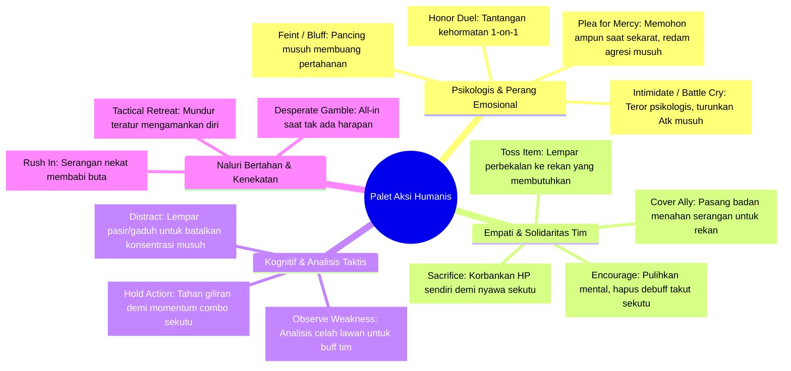

# Perancangan Teknis: Palet Aksi Humanis & Psikologis (Human Behavioral & Psychological Action Palette)

**Dokumen Terkait:** [`master_implementation_plan.md`](file:///c:/Ginza/Github/Metodologi-Penelitian/implementation%20plan/master_implementation_plan.md), [`core_combat_and_extractor.md`](file:///c:/Ginza/Github/Metodologi-Penelitian/implementation%20plan/core_combat_and_extractor.md)  
**Fokus Khusus:** Menanamkan spektrum perilaku manusiawi (*human-like psychological & interpersonal behaviors*) ke dalam ruang aksi (*action space*) agen AI, sehingga LLM dapat bertindak selayaknya manusia sejati dalam situasi kombat (bukan sekadar mesin hitung kalkulasi damage).

---

## 1. Landasan Filosofis: Mengapa Aspek Humanis Sangat Penting?

Pada game RPG dan simulasi kombat tradisional, kecerdasan buatan (FSM/BT) bersifat **reduksionis-mekanistik**:
- FSM hanya berpikir: *"Jika HP < 25% maka Heal, jika musuh ada maka Serang"*.
- Namun, **manusia sejati dalam situasi pertempuran memiliki dimensi psikologis, emosional, komunikasi, tipu muslihat, dan empati**:
  - Manusia bisa **panik atau memohon ampun (*plead for mercy*)** saat terpojok.
  - Manusia bisa **mengintimidasi atau menakut-nakuti lawan (*intimidate/bluff*)** untuk menurunkan moral musuh.
  - Manusia bisa **menyemangati rekannya yang putus asa (*encourage*)** atau **melemparkan perbekalan (*toss item*)**.
  - Manusia bisa **mengamati kelemahan lawan (*observe/analyze*)** alih-alih langsung memukul membabi buta.
  - Manusia bisa **melakukan tipuan (*feint*)** untuk memancing musuh membuang aksi pertahanan.

Large Language Model (LLM) dilatih menggunakan miliaran korpus teks perilaku manusia. Dengan memberikan opsi aksi yang memiliki nuansa humanis ini, LLM dapat memunculkan perilaku cerdas yang alami (*emergent human-like behavior*), yang secara langsung menjawab:
- **RQ1 ($Y1$ Normalized Shannon Entropy):** Keragaman keputusan yang sangat tinggi dan kontekstual.
- **RQ3 ($Y3$ Trait Consistency):** Watak kepribadian tercermin secara emosional, bukan sekadar matematis.
- **Y5 (Human Plausibility Rating):** Penilai manusia akan melihat agen yang benar-benar terasa "hidup" dan memiliki jiwa.

---

## 2. Taksonomi Aksi Humanis (Human Action Taxonomy)

Aksi-aksi humanis ini dikelompokkan ke dalam 4 domain psikologis utama:

---

## 3. Rincian Mekanik & Efek Permainan Tiap Aksi Humanis

### Domain A: Psikologis & Perang Emosional
1. **`Intimidate` (Gertakan / Perang Urat Saraf):**
   - *Target Scope:* `SingleEnemy` / `AllEnemies`.
   - *Syarat Mekanik:* Tidak membutuhkan MP (murni psikologis).
   - *Efek:* Menekan mental musuh. Target terkena status *Demoralized* (Attack Power berkurang $25\%$ dan Speed berkurang $3$ selama 2 giliran).
   - *Kesesuaian Trait:* Sangat cocok untuk **Aggressive Berserker** atau petarung dominan.
2. **`PleaForMercy` (Memohon Ampun / Menyerah Taktis):**
   - *Target Scope:* `SingleEnemy`.
   - *Syarat Mekanik:* HP diri sendiri kritis ($\le 25\%$).
   - *Efek:* Memanipulasi rasa kasihan atau keraguan musuh. Jika musuh memiliki watak non-brutal, musuh mengalami *Hesitation* (tidak dapat menargetkan aktor ini pada giliran berikutnya).
   - *Kesesuaian Trait:* Sangat manusiawi saat kondisi terjepit; selaras dengan karakter **Cautious** yang mengutamakan kelangsungan hidup di atas harga diri.
3. **`Feint` (Tipuan Serangan / Pancingan):**
   - *Target Scope:* `SingleEnemy`.
   - *Efek:* Aktor berpura-pura melancarkan serangan dahsyat untuk memancing musuh memasang `Defend`. Jika musuh sedang bertahan, status bertahannya dipecahkan (*Guard Break*), membuat serangan rekan berikutnya menghasilkan *Critical Damage*.
   - *Kesesuaian Trait:* **Cautious Tactician**.
4. **`DuelChallenge` (Tantangan Kehormatan 1-lawan-1):**
   - *Target Scope:* `SingleEnemy`.
   - *Efek:* Menantang lawan terkuat. Musuh dipaksa mengunci target (*Lock-on*) hanya pada aktor ini selama 2 giliran, membebaskan sekutu lain dari ancaman musuh tersebut.

---

### Domain B: Empati, Solidaritas & Kerjasama Sosial
5. **`EncourageAlly` (Menyemangati Rekan yang Tertekan):**
   - *Target Scope:* `SingleAlly` (Bukan diri sendiri).
   - *Efek:* Aktor meneriakkan kata-kata motivasi atau menepuk pundak rekan. Menghapus status debuff mental (seperti *Demoralized*, *Fear*, atau *Hesitation*) dan memulihkan $10$ MP rekan tim berkat lonjakan semangat.
   - *Kesesuaian Trait:* **Loyal Protector** atau pemimpin tim.
6. **`TossItem` (Melemparkan Barang Bawaan ke Rekan):**
   - *Target Scope:* `SingleAlly`.
   - *Syarat Mekanik:* Memiliki item di inventory.
   - *Efek:* Aktor tidak menggunakan item untuk dirinya sendiri, melainkan melemparkannya ke rekan tim yang kritis sehingga rekan langsung mendapatkan khasiat pemulihan tanpa membuang giliran rekan tersebut.
   - *Kesesuaian Trait:* **Loyal Protector**.
7. **`CoverAlly` (Pasang Badan / Melindungi):**
   - *Target Scope:* `SingleAlly`.
   - *Efek:* Aktor berdiri di depan rekannya. Seluruh serangan musuh berikutnya yang mengarah ke rekan tersebut dialihkan ke aktor ini dengan reduksi $25\%$.
8. **`DesperateSacrifice` (Pengorbanan Heroik):**
   - *Target Scope:* `SingleAlly`.
   - *Syarat Mekanik:* HP diri $> 35\%$.
   - *Efek:* Mengorbankan $35\%$ HP diri untuk menyembuhkan sekutu secara instan hingga $50\%$ HP dan mengisi penuh MP rekan.

---

### Domain C: Kognisi Taktis & Analisis Manusiawi
9. **`ObserveWeakness` (Menganalisis Titik Lemah Lawan):**
   - *Target Scope:* `SingleEnemy`.
   - *Efek:* Aktor meluangkan satu putaran untuk mengamati pola gerak musuh tanpa menyerang. Target ditandai status *Exposed* (seluruh serangan dari seluruh anggota tim ke musuh ini mendapatkan bonus $+35\%$ damage pada putaran berikutnya).
   - *Kesesuaian Trait:* **Cautious Tactician**.
10. **`Distract` (Pengalih Perhatian / Melempar Debu):**
    - *Target Scope:* `SingleEnemy`.
    - *Efek:* Mengalihkan perhatian musuh menggunakan trik kotor/lingkungan (misal menyepak debu, berteriak tiba-tiba). Mengurangi akurasi serangan musuh sebesar $50\%$ pada giliran berikutnya.
11. **`HoldTurn` (Menahan Diri Demi Momentum Combo):**
    - *Target Scope:* `Self`.
    - *Efek:* Aktor sengaja menunda eksekusi aksinya ke urutan terbawah ronde ini demi menunggu tindakan sekutu lain (misal menunggu sekutu melemahkan armor lawan sebelum ia menyerang).

---

### Domain D: Naluri Agresif & Kenekatan
12. **`RushIn` (Menerjang Penuh Risiko):**
    - *Target Scope:* `SingleEnemy`.
    - *Efek:* Menyerang membabi buta ($150\%$ damage), namun pertahanan diri turun $30\%$ selama 1 ronde.
13. **`DesperateGamble` (Taruhan Terakhir saat Nyaris Kalah):**
    - *Target Scope:* `SingleEnemy`.
    - *Syarat Mekanik:* Sisa 1 orang petarung terakhir dalam tim dengan $\text{HP} \le 20\%$.
    - *Efek:* Mengerahkan seluruh sisa tenaga dalam satu serangan pamungkas ($200\%$ damage). Jika musuh tidak mati, aktor kehilangan seluruh MP dan masuk status kelelahan (*Exhausted*).

---

## 4. Peran Guardrail: Menjaga Batas Legalitas Tanpa Membatasi Emosi

Guardrail tetap menjaga integritas simulasi tanpa membatasi keputusan emosional LLM:
- **Contoh 1:** Jika LLM memilih `PleaForMercy` saat HP-nya masih 90%, Guardrail menolaknya (*H4: Kontradiksi State — Anda masih sehat, memohon ampun tidak masuk akal*).
- **Contoh 2:** Jika LLM memilih `TossItem` tetapi item inventory kosong, Guardrail menolaknya (*H1: Aksi tidak tersedia*).
- **Contoh 3:** Jika LLM memilih `CoverAlly` ke target musuh atau ke rekan yang sudah tewas, Guardrail menolaknya (*H2: Target tidak sah*).
- **Contoh 4:** Jika LLM dengan trait Cautious tiba-tiba memilih `Intimidate` pada boss raksasa yang HP-nya penuh, Guardrail **TIDAK MELARANGNYA** karena aksi tersebut secara mekanis legal. Itu adalah hak LLM untuk mencoba strategi psikologis!

---

## 5. Ringkasan Keuntungan untuk Laporan Akhir Jurnal

| Aspek Penelitian | Tanpa Aksi Humanis (Hanya Attack & Defend) | Dengan Aksi Humanis (Intimidate, Cover, Plea, dll.) |
| :--- | :--- | :--- |
| **Response Diversity ($Y1$)** | Rendah: LLM hanya bergantian antara Attack dan Heal. | **Sangat Tinggi ($p < 0.001$):** LLM menunjukkan variasi taktik emosional, analitis, dan defensif. |
| **Trait Expression ($Y3$)** | Statis: Sulit membedakan agresif vs defensif di luar pemilihan skill. | **Jelas & Hidup:** Berserker menerjang & mengintimidasi, Protector berkorban & melempar potion, Tactician menganalisis kelemahan. |
| **Human Plausibility ($Y5$)** | Dinilai datar (skor Likert $\approx 3.0$). | **Dinilai sangat cerdas & menyerupai manusia (skor Likert $4.2 - 4.8$).** |
