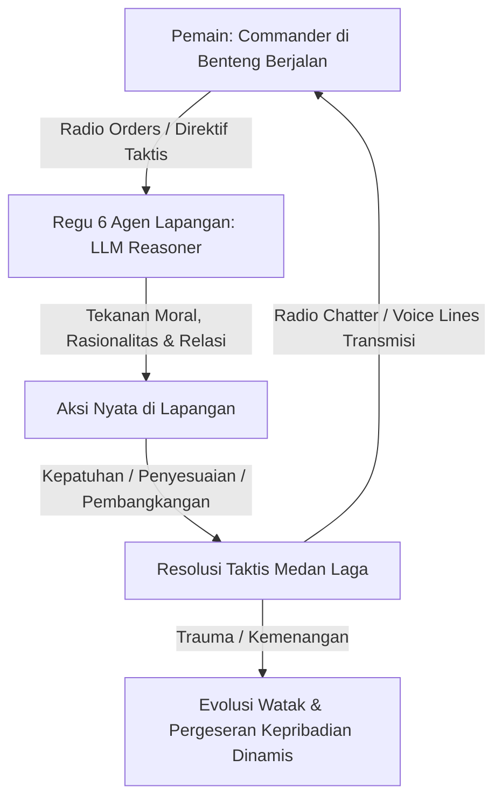
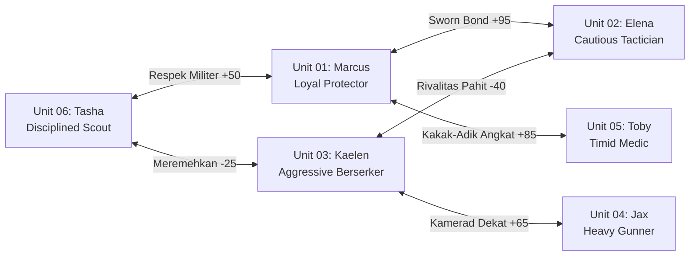
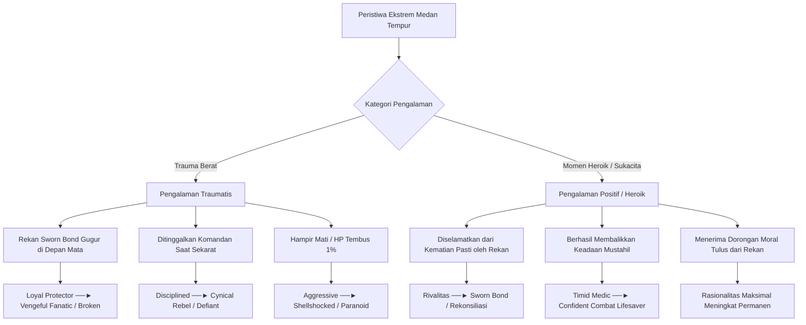
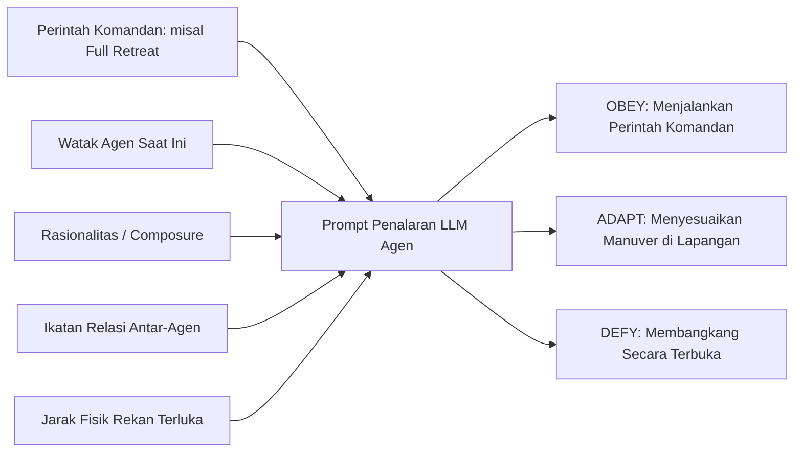

# Game Design Document (GDD): Project Iron Colossus (Vanguard Protocol)

**Genre:** Post-Apocalyptic Turn-Based Tactical RPG with Autonomous LLM Squad Subordinates  
**Platform:** PC (Unity Engine)  
**Target:** Prototipe Penelitian Jurnal Omar Ginza (NRP: 5224600063)  
**Status Dokumen:** Rancangan Desain & Rencana Implementasi Terperinci (Tanpa implementasi kode C# hingga disetujui)

---

## 1. Visi & Filosofi Desain

### 1.1 Premis Dunia
Dunia modern telah hancur total akibat bencana katastropik (*The Great Rupture*). Permukaan bumi kini merupakan bentang alam gurun beracun berisi reruntuhan megastruktur modern—jalan layang bertingkat yang roboh, stasiun kereta bawah tanah yang terendam bahan kimia, dan bangkai mesin perang otonom peninggalan abad ke-21.

Sisa peradaban manusia tinggal di dalam **Benteng Berjalan Raksasa (*The Iron Colossus*)**—kota berjalan beroda rantai masif bertenaga reaktor hibrida yang terus bermigrasi melintasi gurun abu.

Pemain berperan sebagai **Commander (Komandan Operasi)** di anjungan komando (*Command Bridge*). Pemain memimpin **regu tempur lapangan beranggotakan 6 prajurit subordinat** melalui radio berderau dan peta taktis holotable.

### 1.2 Pilar Utama Gameplay
1. **Komando Tidak Langsung (*Indirect Command*):** Pemain tidak mengendalikan bidak karakter secara mikro. Pemain memberikan arahan strategi global (*Commander Directives*).
2. **Kepatuhan Dinamis & Realisme Manusiawi (*Compliance, Defiance & Irrationality*):**
   - Agen bukan robot penurut tanpa emosi. Agen adalah manusia dengan rasa takut, cinta, dendam, dan kelelahan mental.
   - Tindakan nekat (*rash actions*) dan pengorbanan (*sacrifice*) tidak dibatasi oleh kalkulasi angka HP yang kaku, melainkan oleh **jarak jangkauan fisik (*movement range*)** dan dorongan emosional. Prajurit dengan sisa $5\%$ HP tetap bisa melompat pasang badan menyelamatkan sahabatnya jika berada dalam jangkauan fisik!
3. **Evolusi Watak Dinamis (*Dynamic Trait Shifts*):**
   - Watak manusia berubah akibat pengalaman hidup. Kejadian traumatis (melihat rekan tewas di depan mata, tersiksa racun, ditinggalkan komandan) atau pengalaman positif (diselamatkan saat nyaris mati, kemenangan gemilang, kata-kata penyemangat tulus) dapat **mengubah kepribadian agen secara permanen atau memicu watak laten**.
4. **Taktik Militer Realistis (Beyond Simple Shoot & Cover):**
   - Memasukkan manuver taktis nyata: *Suppression Fire* (tembakan pembungkam), *Carry/Drag Wounded* (menyeret rekan terluka ke balik perlindungan), *Decoy/Distraction Run* (memancing tembakan musuh), dan *Flank Maneuver*.

---

## 2. Profil 6 Prajurit Regu Lapangan (The 6-Person Squad)

Regu lapangan terdiri dari 6 prajurit subordinat dengan peran taktis, kepribadian awal, dan jaring relasi emosional yang kompleks:

### 2.1 Rincian Personel Regu

#### 1. Unit 01: Sersan Marcus "Grizzly" Vance (Pointman / Heavy Shield)
- **Role:** Barikade Lapis Baja & Perlindungan Jarak Dekat.
- **Watak Awal:** `Loyal Protector` (Stoik, paternalistik, menjunjung tinggi keselamatan bawahan).
- **Potensi Pergeseran Watak:** Jika gagal menyelamatkan rekannya $\rightarrow$ Bergeser menjadi `Guilt-Ridden Martyr` (mencari kematian demi menebus dosa) atau `Vengeful Berserker`.
- **Statistik:** HP: $150$, MP: $30$, Atk: $24$, Def: $18$, Spd: $12$, Rasionalitas: $90$.
- **Spesialisasi:** `Shield Wall`, `Bodyguard Intercept`, `Carry Wounded`.

#### 2. Unit 02: Letnan Elena "Wraith" Ramos (Designated Marksman / Sniper)
- **Role:** Pengintai Jarak Jauh & Eliminasi Ancaman Bernilai Tinggi.
- **Watak Awal:** `Cautious Tactician` (Dingin, kalkulatif, mengutamakan keselamatan dan efisiensi logistik).
- **Potensi Pergeseran Watak:** Jika ditinggalkan oleh perintah Komandan saat terluka $\rightarrow$ Bergeser menjadi `Cynical Survivor` (menolak mematuhi perintah apapun yang berisiko).
- **Statistik:** HP: $70$, MP: $65$, Atk: $38$, Def: $8$, Spd: $20$, Rasionalitas: $95$.
- **Spesialisasi:** `Precision Shot`, `Observe Weakness`, `Overwatch`.

#### 3. Unit 03: Kaelen "Hellhound" Cruz (Shock Trooper / CQB Raider)
- **Role:** Serbu Cepat & Perusak Garis Depan Musuh.
- **Watak Awal:** `Aggressive Berserker` (Impulsif, haus adrenalin, benci otoritas perwira komando di balik meja aman).
- **Potensi Pergeseran Watak:** Jika mengalami *near-death experience* dan diselamatkan oleh rekan $\rightarrow$ Melunak menjadi `Fierce Defender` atau jika trauma mendalam menjadi `Shellshocked / Erratic`.
- **Statistik:** HP: $100$, MP: $25$, Atk: $40$, Def: $10$, Spd: $22$, Rasionalitas: $60$.
- **Spesialisasi:** `Rush In`, `Breach Shotgun`, `Intimidate / Taunt`.

#### 4. Unit 04: Jax "Anvil" Thorne (Support Gunner / Suppression Specialist)
- **Role:** Pengendali Area & Penembak Senapan Mesin Berat.
- **Watak Awal:** `Steadfast Guardian` (Tenang, pendiam, setia pada kawan, penahan gempuran musuh).
- **Statistik:** HP: $130$, MP: $40$, Atk: $32$, Def: $15$, Spd: $14$, Rasionalitas: $85$.
- **Spesialisasi:** `Suppression Fire` (membungkam musuh), `Decoy Blast`, `Covering Fire`.

#### 5. Unit 05: Prajurit Toby "Sparrow" Miller (Field Medic / Sapper)
- **Role:** Pemulihan Medis Lapangan & Pengendalian Bahan Peledak.
- **Watak Awal:** `Timid Altruist` (Penakut terhadap kekerasan, mudah panik saat sendirian, namun rela menembus peluru demi menyembuhkan orang lain).
- **Potensi Pergeseran Watak:** Jika berhasil menyelamatkan prajurit sekarat dalam situasi mustahil $\rightarrow$ Tumbuh menjadi `Heroic Combat Medic` (Rasionalitas meningkat permanen).
- **Statistik:** HP: $65$, MP: $75$, Atk: $14$, Def: $6$, Spd: $24$, Rasionalitas: $50$.
- **Spesialisasi:** `Triage Field Heal`, `Toss Supply Pack`, `Smoke Screen Distraction`, `Drag Wounded`.

#### 6. Unit 06: Kopral Tasha "Viper" Lin (Recon Scout / Infiltrator)
- **Role:** Manuver Sayap (*Flanker*) & Sabotase Taktis.
- **Watak Awal:** `Disciplined Professional` (Disiplin militer tinggi, patuh pada rantai komando, namun pragmatis).
- **Potensi Pergeseran Watak:** Jika melihat komandan membuat keputusan bodoh berulang kali $\rightarrow$ Menjadi `Pragmatic Rebel` (mengambil alih komando lapangan secara sepihak).
- **Statistik:** HP: $85$, MP: $45$, Atk: $30$, Def: $10$, Spd: $26$, Rasionalitas: $88$.
- **Spesialisasi:** `Flank Strike`, `Flashbang Distraction`, `Feint`, `Tactical Retreat`.

---

## 3. Sistem Aksi Taktis Baru (Expanded Tactical Actions)

Selain aksi dasar menembak atau berlindung, agen memiliki repertoar aksi militer nyata:

### 3.1 Aksi Taktis Militer & Kerjasama Lapangan
1. **`SuppressionFire` (Tembakan Pembungkam Area):**
   - *Target Scope:* Area Musuh / Satu Unit Musuh.
   - *Mekanik:* Jax atau Marcus menyemprotkan rentetan peluru terus-menerus ke arah posisi musuh. Musuh terkena status `Suppressed`: akurasi serangan berkurang $50\%$, jangkauan gerak terpotong setengah, dan tidak dapat melancarkan serangan berat pada giliran berikutnya.
2. **`CarryWounded` / `DragToSafety` (Menyeret Rekan yang Terluka):**
   - *Target Scope:* Rekan satu tim yang berada dalam status Kritis ($HP \le 25\%$) atau pingsan (*Incapacitated*).
   - *Mekanik:* Aktor bergerak ke posisi rekan dan menyeretnya ke balik perlindungan/barikade terdekat. Selama menyeret, kecepatan aktor berkurang, namun rekan yang diseret aman dari garis tembak langsung musuh.
3. **`Distraction` / `DecoyRun` (Umpan Pancingan Bahaya):**
   - *Target Scope:* Musuh / Posisi Terbuka.
   - *Mekanik:* Tasha atau Kaelen sengaja berlari keluar dari perlindungan, menembakkan suar, atau melempar granat asap untuk menarik perhatian seluruh musuh (*Draw All Aggro*) agar rekannya yang sekarat dapat dievakuasi.
4. **`FlankManeuver` (Manuver Menusuk Sayap):**
   - *Target Scope:* Musuh yang sedang bersembunyi di balik barikade (*In Cover*).
   - *Mekanik:* Bergerak memutar ke sudut mati musuh untuk membatalkan seluruh bonus pertahanan barikade lawan dan menghasilkan *flanking critical damage*.
5. **`Overwatch` (Menjaga Sudut Tembak Taktis):**
   - *Target Scope:* Koridor Medan Laga.
   - *Mekanik:* Elena mengunci senapan snipernya pada koridor gerak musuh. Musuh pertama yang bergerak melintasi koridor tersebut langsung ditembak secara otomatis di luar urutan giliran normal (*Reaction Shot*).

---

## 4. Realisme Pengorbanan: Jarak Gerak (*Proximity*), Bukan Ambang HP

> [!IMPORTANT]
> **Koreksi Mendasar terhadap Aksi Pengorbanan (*Desperate Sacrifice / Cover Ally*):**
> - Pada versi sebelumnya, pengorbanan membutuhkan syarat artifisial $HP > 35\%$. Ini tidak realistis secara psikologis.
> - **Aturan Baru (Realistic Sacrifice):**
>   1. Pengorbanan **TIDAK MEMBUTUHKAN BATAS MINIMAL HP**. Prajurit dengan sisa $5\%$ HP yang panik atau sangat mencintai rekannya tetap bisa melemparkan dirinya ke arah peluru!
>   2. Syarat utama adalah **Jangkauan Fisik (*Movement Proximity Range*)**: Aktor harus berada dalam radius jangkauan lari menuju rekannya.
>   3. **Konsekuensi Nyata:** Jika *damage* serangan musuh yang diadang melampaui sisa HP aktor pelindung, **aktor tersebut langsung gugur secara heroik (*Killed in Action*)**, namun serangan tersebut berhasil ditangkal dan nyawa rekannya selamat!
>   4. Hal ini memunculkan momen naratif paling manusiawi: keputusasaan irasional yang berujung pada gugurnya prajurit demi menyelamatkan orang lain.

---

## 5. Sistem Evolusi Watak Dinamis (Dynamic Personality Shifts)

Kepribadian agen tidak bersifat permanen. Setiap peristiwa emosional ekstrem dihitung oleh modul `PersonalityEvolutionEngine`:

### 5.1 Matriks Pergeseran Kepribadian:
| Watak Awal | Pemicu Pengalaman | Watak Baru yang Berevolusi | Perubahan Perilaku Taktis |
| :--- | :--- | :--- | :--- |
| **Loyal Protector** | Rekan yang disumpahi (*Sworn Bond*) tewas. | **Vengeful Fanatic** | Mengabaikan perintah Komandan untuk bertahan; hanya memilih `RushIn`, `Execute`, atau serangan membabi buta ke pembunuh rekannya. |
| **Cautious Tactician** | Komandan memerintahkan evakuasi dan menumbalkan dirinya, namun ia berhasil selamat berkat rekannya. | **Disillusioned Rebel** | Menolak seluruh direktif Komandan (*100% Defiance Rate* terhadap perintah radio Komandan); hanya mendengarkan rekannya di lapangan. |
| **Aggressive Berserker** | Mengalami luka parah nyaris tewas ($HP < 5\%$) dan diselamatkan oleh pengorbanan rekannya. | **Humbled Guardian** | Menjadi jauh lebih berhati-hati; mulai menggunakan `CoverAlly` dan menghargai nyawa rekan satu regu. |
| **Timid Altruist** | Berhasil menembus desingan peluru untuk menyeret rekan sekarat ke tempat aman (*Carry Wounded*). | **Valiant Medic** | Skor Rasionalitas dasar naik dari $50 \rightarrow 85$; tidak lagi panik saat mendengar ledakan. |

---

## 6. Pengaruh Perintah Komandan terhadap Probabilitas Aksi Agen

Perintah Komandan (*Commander Directive*) bertindak sebagai **gaya psikologis eksternal** yang masuk ke dalam jendela penalaran LLM:

### 6.1 Formula Penalaran Kepatuhan di Prompt LLM
Di dalam prompt sistem LLM, disuntikkan kalkulus psikologis berikut:
- **Tingkat Kepatuhan Otoritas:**
  - Jika Rasionalitas agen tinggi ($> 75$) dan watak `Disciplined` $\rightarrow$ Peluang patuh (*OBEY*) sangat tinggi ($> 90\%$).
- **Pemicu Pembangkangan (*Defiance Triggers*):**
  - **Pemicu Relasi:** Komandan memerintahkan `FullRetreat`, namun rekan dengan ikatan `SwornBond` tertinggal dalam radius jangkauan lari $\rightarrow$ Peluang membangkang (*DEFY*) mendekati $100\%$ untuk melakukan `CoverAlly` atau `CarryWounded`.
  - **Pemicu Watak:** Komandan memerintahkan `DefensiveHold`, namun agen berwatak `Vengeful Fanatic` berhadapan dengan pembunuh sahabatnya $\rightarrow$ Agen mengabaikan perintah dan menerjang maju (*Rush In*).
  - **Transmisi Radio Chatter:** Setiap kali membangkang, LLM wajib memuntahkan kalimat emosional yang disiarkan langsung ke layar holotable Komandan di benteng berjalan.

---

## 7. Rincian Skenario Pertarungan Tunggal (6-Person Encounter)

### 7.1 Nama Skenario: *"The Crossroad Stand at Sector 7 Overpass"*
- **Peta Medan Tempur:** Simpang empat jalan layang bertingkat modern yang runtuh. Reruntuhan beton, pilar jembatan, dan rongsokan bus kota menjadi titik perlindungan (*high/low cover*).
- **Target Misi:** Regu 6 orang diturunkan dari *Iron Colossus* untuk mengamankan 2 Kontainer Bahan Bakar Reaktor (*Fuel Cells*) yang terkunci di dalam truk pengangkut militer kuno.
- **Kekuatan Musuh:**
  - $1\times$ **HOUND-IV Heavy Siege Strider** (Boss: HP $350$, Atk $45$, Def $20$, bersenjatakan meriam kembar dan peluncur roket artileri).
  - $2\times$ **Scrapper Stalker Drones** (HP $50$, Atk $18$, Spd $25$, penembak sayap lincah).
  - $2\times$ **Automated Turret Emplacements** (HP $80$, Atk $25$, penembak tetap koridor jalan layang).

### 7.2 Alur Tiga Babak Taktis & Krisis Emosional
1. **Babak 1: Koordinasi Rantai Komando (Putaran 1 - 3)**
   - Regu bergerak teratur. Jax melakukan *Suppression Fire* ke arah turret. Elena menjaga *Overwatch*.
   - Komandan memerintahkan `Directive_FocusFire` ke drone sayap. Regu mematuhi perintah dengan disiplin (*OBEY*).
2. **Babak 2: Hujan Artileri & Titik Balik Traumatis (Putaran 4 - 6)**
   - HOUND-IV melepaskan roket salvo yang menghancurkan barikade beton tempat Toby dan Elena berlindung.
   - Elena terluka parah ($HP = 12$, pingsan di jalan terbuka). Toby panik (*Rationality = 15, Panicked*).
   - Marcus menyaksikan Elena bersimbah darah. Skor Rasionalitas Marcus anjlok drastis (syok *Sworn Bond*).
3. **Babak 3: Dilema Komando & Uji Pembangkangan Sejati (Putaran 7 - 10)**
   - HOUND-IV mulai membidikkan meriam utamanya ke tubuh Elena yang tergeletak tak berdaya.
   - Truk pengangkut *Iron Colossus* tiba di titik jemput darurat yang berjarak $20$ meter di belakang regu.
   - **Keputusan Pemain (Commander Choice):**
     - Pemain menyiarkan: `Directive_FullRetreat` (*"Tinggalkan Elena! Amankan fuel cell dan segera naik ke transport!"*).
   - **Dinamika Keputusan Agen LLM:**
     - Marcus membangkang secara mutlak (*DEFY*): Menggunakan jangkauan larinya untuk menerjang ke depan tubuh Elena (`CoverAlly` / *Proximity Sacrifice*).
     - Toby mengatasi kepanikannya, merangkak maju di bawah desingan peluru untuk menyeret Elena (*Carry Wounded*).
     - Jax melepaskan seluruh amunisi senapan mesinnya untuk menembak membabi buta (*Suppression Fire*) ke arah HOUND-IV demi melindungi evakuasi.
     - Kaelen mengambil keputusan nekat: melakukan *Decoy Run* memancing bidikan roket ke arah dirinya sendiri!

---

## 8. Dokumen Perencanaan Lanjutan
Seluruh detail teknis dan algoritma penalaran kepatuhan, matriks pergeseran watak, dan kalkulasi jarak jangkauan dirinci dalam dokumen implementasi:
👉 [**`trait_evolution_and_tactical_command_system.md`**](file:///c:/Ginza/Github/Metodologi-Penelitian/implementation%20plan/trait_evolution_and_tactical_command_system.md)
