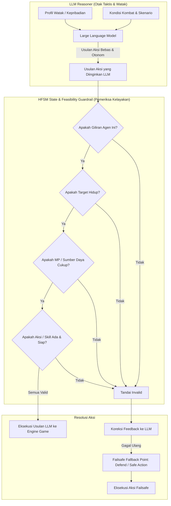

# Perancangan Teknis: HFSM Guardrail & Baseline Agent

Dokumen ini merinci arsitektur, peran, dan batas tanggung jawab dari **HFSM (Hierarchical Finite State Machine)** dalam penelitian jurnal Omar Ginza.

---

## 1. Prinsip Utama: Pemisahan Peran LLM vs HFSM

> [!IMPORTANT]
> **Prinsip Inti Arsitektur:**
> - **LLM adalah Pengambil Keputusan Penuh (*Decision Maker*):** LLM bertugas menalar situasi pertarungan, merespons skenario, memilih strategi, dan mengekspresikan watak kepribadian (*trait*).
> - **HFSM BUKAN Pengendali Taktik / Trait:** HFSM sama sekali tidak mendikte agen harus melakukan apa berdasarkan skenario atau kepribadian. Peran HFSM pada arsitektur Hybrid dibatasi secara ketat sebagai **State Verifier / Feasibility Guardrail** (pemeriksa apakah aksi yang diinginkan LLM secara mekanik memungkinkan atau tidak) dan **Failsafe Fallback Point** jika usulan LLM rusak/tidak valid.



---

## 2. Peran HFSM dalam Dua Konteks Berbeda

Untuk menghindari kerancuan, HFSM didefinisikan dalam dua konteks yang terpisah:

### 2.1 Konteks 1: Standar Baseline Mandiri ($X1 = \text{HFSM Murni}$)
- Digunakan semata-mata sebagai agen pembanding konvensional (*benchmark*) untuk mengukur performa agen non-LLM di game RPG turn-based (mengacu pada Arif dkk., 2011 dan Fauzi dkk., 2019).
- Pada mode ini, HFSM berjalan mandiri menggunakan aturan tetap (rule-based) tanpa keterlibatan LLM sama sekali.

### 2.2 Konteks 2: Guardrail & Fallback pada Agen Hybrid ($X1 = \text{Hybrid}, X2 = \text{Dengan Pembatasan}$)
- **HFSM sama sekali TIDAK mengatur taktik atau membaca trait.**
- Seluruh keputusan aksi (`action_id`, `target_id`, dan penalaran) diusulkan secara otonom oleh LLM berdasarkan pemahaman LLM terhadap kondisi kombat dan kepribadiannya.
- **Tugas HFSM Guardrail:**
  1. **Pemeriksaan Kelayakan Mekanik (Feasibility Check):**
     - Memeriksa apakah aktor yang bertindak adalah entitas yang sah gilirannya.
     - Memeriksa apakah target masih hidup (`target.is_alive == true`) dan berada dalam scope yang diizinkan (musuh vs sekutu).
     - Memeriksa apakah MP agen mencukupi untuk biaya skill yang diinginkan (`actor.mp >= skill.mp_cost`).
     - Memeriksa apakah item yang ingin digunakan masih ada di inventory (`item.quantity > 0`).
     - Memeriksa apakah jurus yang dipanggil sedang dalam status *cooldown*.
  2. **Penyedia Titik Cadangan (Failsafe Fallback Point):**
     - Jika LLM mengusulkan aksi yang mustahil/rusak (halusinasi) dan setelah diberi 1x feedback retry masih tetap mengembalikan input tidak valid, Guardrail mengaktifkan *fallback point* yang aman (misalnya: aksi `Defend` legal atau `BasicAttack` pada target sah terdekat).
     - Hal ini mencegah engine game mengalami *infinite loop*, *null reference exception*, atau permainan terhenti (*softlock*), sembari mencatat kegagalan tersebut sebagai metrik **Y2 (Illogical Decision Rate)**.

---

## 3. Matriks Pemeriksaan Feasibility Guardrail

Guardrail mengevaluasi usulan aksi LLM murni berdasarkan status mekanik game (*state invariants*):

| Parameter Uji | Aturan Validitas Game State | Konsekuensi Jika Melanggar | Kategori Halusinasi ($Y2$) |
| :--- | :--- | :--- | :---: |
| **Turn Ownership** | `snapshot.current_actor.id == proposed_actor_id` | Tolak usulan aksi | **H3** (Aturan Permainan) |
| **Target Vitality** | `target.is_alive == true` | Tolak usulan aksi | **H2** (Target Tidak Sah) |
| **Target Scope** | Musuh untuk aksi serang, Sekutu/Diri sendiri untuk heal/buff | Tolak usulan aksi | **H2** (Target Tidak Sah) |
| **MP Availability** | `actor.mp >= skill.mp_cost` | Tolak usulan aksi | **H1** (Aksi Tak Tersedia) |
| **Item Availability**| `inventory[item_id].quantity > 0` | Tolak usulan aksi | **H1** (Aksi Tak Tersedia) |
| **Skill Cooldown** | `skill.current_cooldown == 0` | Tolak usulan aksi | **H1** (Aksi Tak Tersedia) |
| **Schema Integrity**| JSON valid memuat `action_id` dan `target_id` sah | Tolak usulan aksi | **H5** (Format Output Rusak) |

---

## 4. Mekanisme Failsafe Fallback Point

Guardrail memiliki titik *fallback* deterministik yang minimalis dan aman:

```csharp
namespace RPGStrategy.AI.Guardrail
{
    public class ActionGuardrail
    {
        public ValidationResult ValidateDesiredAction(CombatStateSnapshot snapshot, LLMActionProposal desiredAction)
        {
            // 1. Validasi Turn
            if (desiredAction.ActorId != snapshot.CurrentActor.Id)
                return ValidationResult.Invalid(ViolationCategory.H3_GameRuleViolation, "Not your turn.");

            // 2. Validasi Skill / Action Existence
            var actionData = snapshot.AvailableActions.FirstOrDefault(a => a.ActionId == desiredAction.ActionId);
            if (actionData == null)
                return ValidationResult.Invalid(ViolationCategory.H1_ActionUnavailable, $"Action '{desiredAction.ActionId}' is not in available actions list.");

            // 3. Validasi MP
            if (snapshot.CurrentActor.MP < actionData.MPCost)
                return ValidationResult.Invalid(ViolationCategory.H1_ActionUnavailable, $"Insufficient MP: Have {snapshot.CurrentActor.MP}, requires {actionData.MPCost}.");

            // 4. Validasi Target
            var target = snapshot.FindEntity(desiredAction.TargetId);
            if (target == null || !target.IsAlive)
                return ValidationResult.Invalid(ViolationCategory.H2_InvalidTarget, $"Target '{desiredAction.TargetId}' is dead or does not exist.");

            // Seluruh pemeriksaan lolos -> Aksi disetujui tanpa campur tangan taktis
            return ValidationResult.Valid();
        }

        public AgentDecision GetFailsafeFallback(CombatStateSnapshot snapshot)
        {
            // Fallback aman: Ambil posisi bertahan (Defend) agar permainan tidak softlock
            return new AgentDecision
            {
                ActionId = "Action_Defend",
                TargetId = snapshot.CurrentActor.Id,
                Reasoning = "Failsafe Fallback triggered due to repeated invalid LLM proposals."
            };
        }
    }
}
```

---

## 5. Ringkasan Batasan

- **Yang dilakukan LLM:** Membaca watak (*trait*), membaca musuh, memilih taktik (apakah mau menyerang musuh lemah, melindungi sekutu, memakai skill AoE, dll.).
- **Yang dilakukan HFSM Guardrail:** Hanya memeriksa *"Apakah aksi yang diminta LLM tersebut bisa dieksekusi secara legal sekarang?"*
  - Jika **BISA** $\rightarrow$ Langsung jalankan pilihan LLM.
  - Jika **TIDAK BISA** $\rightarrow$ Minta koreksi (retry), dan jika tetap tidak bisa, berikan tindakan darurat aman (*fallback*) agar game tetap berjalan sembari mencatat log pelanggaran.
