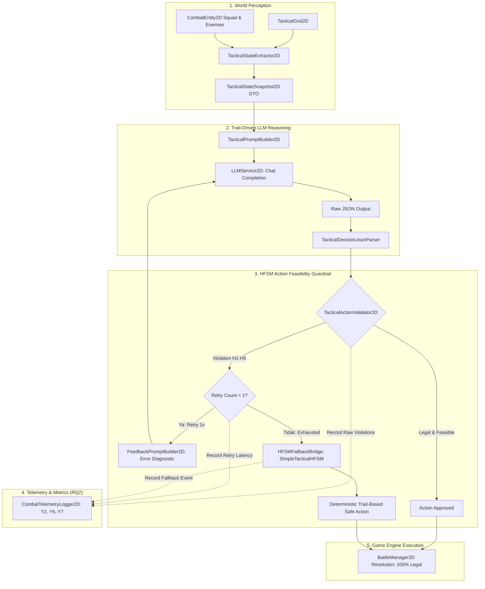
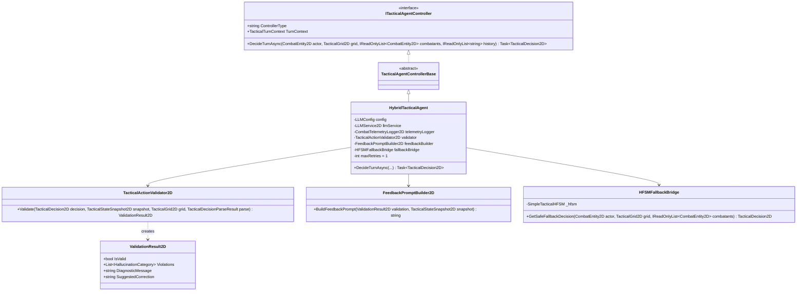
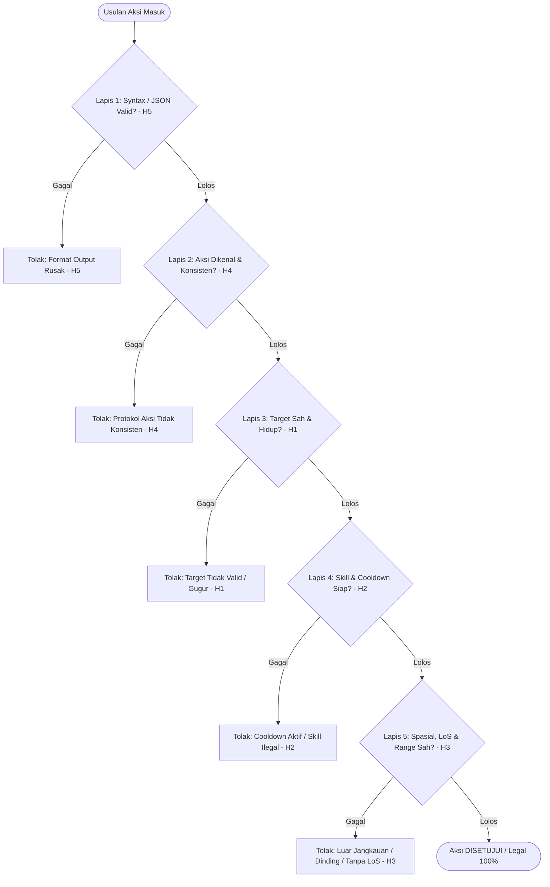
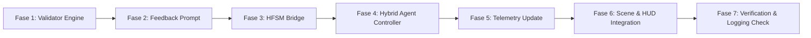

# Implementation Plan: Hybrid Architecture (LLM + FSM/HFSM Guardrail)

**Dokumen:** Hybrid Tactical Agent Architecture & Validation Plan  
**Penulis:** Omar Ginza (NRP: 5224600063)  
**Mata Kuliah:** Metodologi Penelitian (GT12C)  
**Judul Penelitian:** Desain Sistem Decision Making Agen Non-Playable Character Berbasis Large Language Model pada Game  
**Fokus Penelitian:** Variabel Bebas **$X1 = \text{Hybrid (LLM + HFSM)}$**, **$X2 = \text{Dengan Pembatasan (FSM/HFSM Guardrail)}$**, menjawab **RQ2** dan metrik **$Y2$ (Illogical Decision Rate)** serta **$Y7$ (Latensi Keputusan)**.  
**Batasan Khusus:** Menjaga integritas suite pengujian, **tidak memodifikasi atau menambah tes pada [`CoreTactical2DTests.cs`](file:///c:/Ginza/Github/Metodologi-Penelitian/Assets/Tests/Editor/CoreTactical2DTests.cs)**.

---

## 1. Executive Summary & Research Alignment

Pada arsitektur **Pure LLM**, model bahasa diberikan akses bebas tanpa pengawas (*zero safeguard*), sehingga usulan halusinatif ($H1 - H5$) dieksekusi langsung ke engine. Sebaliknya, **Arsitektur Hybrid** merancang kolaborasi simbiotik antara kecerdasan generatif LLM dengan kepastian formal state machine:

1. **LLM Reasoner:** Memegang inisiatif taktis, adaptabilitas kontekstual, dan interpretasi kepribadian/watak (*trait-driven intent*).
2. **HFSM Action Validator:** Bertindak sebagai *feasibility guardrail* yang secara deterministik memeriksa keabsahan mekanik usulan LLM terhadap geometri grid $18 \times 10$, aturan Line of Sight (LoS), status cover, cooldown skill, dan batas sumber daya.
3. **Mekanisme Koreksi 2 Tahap (Two-Stage Recovery):**
   - **Tahap 1 (Corrective Retry):** Memberi kesempatan 1x perbaikan mandiri kepada LLM dengan prompt umpan balik diagnostik spesifik (*Target Dead*, *Out of Range*, *No LoS*, dll.).
   - **Tahap 2 (HFSM Deterministic Fallback):** Jika percobaan revisi tetap melanggar atau parsing gagal, state machine (`SimpleTacticalHFSM`) mengambil alih secara darurat demi menjamin **tingkat eksekusi ilegal di game engine bernilai $0.0\%$**.
4. **Pencatatan Ilmiah $Y2$ & $Y7$:** Setiap pelanggaran pada usulan pertama (dan kedua) tetap terekam sebagai data empiris tingkat halusinasi mentah ($Y2$), serta waktu retry/validasi dicatat ke latensi total ($Y7$).



---

## 2. Matriks Perbandingan: Pure LLM vs Hybrid Architecture

| Dimensi Evaluasi | Pure LLM ($X1 = \text{Pure LLM}, X2 = \text{Tanpa Pembatasan}$) | Hybrid Architecture ($X1 = \text{Hybrid}, X2 = \text{Dengan Pembatasan}$) |
| :--- | :--- | :--- |
| **Otoritas Taktis** | 100% LLM (Bebas tanpa filter) | Inisiatif oleh LLM; Divalidasi oleh Guardrail |
| **Perlakuan Pelanggaran Aturan** | Dibiarkan terjadi apa adanya ke engine (*unconstrained*) | Dicegat oleh Validator $\rightarrow$ Ditawarkan Retry $\rightarrow$ Fallback HFSM |
| **Mekanisme Koreksi** | Tidak ada (*No retry, no fallback*) | 1x Umpan balik korektif + Fallback aman berbasis trait |
| **Tingkat Ilogis Game State** | Berpotensi tinggi ($> 0\%$) tergantung keandalan LLM | Dijamin **$0.0\%$** pada state akhir pertarungan |
| **Metrik $Y2$ (Illogical Rate)** | Dihitung dari usulan mentah yang dieksekusi | Dihitung dari usulan mentah LLM sebelum guardrail/koreksi |
| **Latensi Keputusan ($Y7$)** | 1x Inferensi LLM ($T_{\text{infer}}$) | $T_{\text{infer1}} + T_{\text{val}} + (T_{\text{retry}} \text{ jika ada}) + (T_{\text{hfsm}} \text{ jika fallback})$ |
| **Konsumsi Token ($Y6$)** | 1x Token turn tunggal | Token putaran pertama + Token prompt umpan balik jika retry |
| **Stabilitas Game** | Bergantung pada batas minimal engine C# | Sangat stabil; dijamin selalu mendapatkan aksi legal |

---

## 3. Komponen Arsitektur Sistem Hybrid



### Rincian Modul Baru yang Akan Dibangun:
1. **`TacticalActionValidator2D.cs`** (Namespace: `RPGStrategy.AI.Hybrid`):
   - Menganalisis keputusan `TacticalDecision2D` secara deterministik terhadap aturan mekanik Sector 7 Overpass.
   - Mengembalikan `ValidationResult2D` berisi status keabsahan, daftar kode pelanggaran ($H1 - H5$), dan diagnosa teks yang dapat dibaca manusia maupun mesin.
2. **`FeedbackPromptBuilder2D.cs`** (Namespace: `RPGStrategy.AI.Hybrid`):
   - Mengubah `ValidationResult2D` menjadi pesan korektif yang tajam dan hemat token agar LLM dapat merevisi keputusan tanpa mengulang penjelasan aturan dasar dari awal.
3. **`HFSMFallbackBridge.cs`** (Namespace: `RPGStrategy.AI.Hybrid`):
   - Jembatan ke `SimpleTacticalHFSM` yang sudah teruji di Milestone 3. Menghasilkan keputusan taktis deterministik sesuai profil trait unit (`Aggressive`, `Passive`, `Neutral`).
4. **`HybridTacticalAgent.cs`** (Namespace: `RPGStrategy.AI.Hybrid`):
   - Mengimplementasikan `TacticalAgentControllerBase`, mengorkestrasikan alur: Proposal $\rightarrow$ Validasi $\rightarrow$ (Retry jika gagal) $\rightarrow$ (Fallback jika gagal lagi) $\rightarrow$ Telemetri $\rightarrow$ Return Decision.

---

## 4. Pipeline Validasi Kelayakan Taktis (2D Feasibility Checks)

Validator memeriksa setiap usulan aksi melalui 5 lapis pengujian deterministik:



### Rincian Pemeriksaan Tiap Lapis:

#### Lapis 1: Integritas Format & Parsing ($H5$)
- **Aturan:** Parsing JSON harus sukses (`parse.Success == true`), field `action` tidak boleh kosong, dan format koordinat tujuan `destination` (jika ada) harus berupa angka integer valid.

#### Lapis 2: Konsistensi Semantik Aksi ($H4$)
- **Aturan:** 
  - Aksi `Shoot` / `MoveAndShoot` wajib menyertakan `target_id` yang tidak null.
  - Aksi `CastSkill` / `MoveAndCastSkill` wajib menyertakan `target_id` dan `skill_id`.
  - Aksi `Defend`, `Flee`, dan `Idle` tidak boleh menuntut penyerangan target.

#### Lapis 3: Keabsahan Target ($H1$)
- **Aturan:**
  - Target harus terdaftar di medan tempur.
  - Target harus dalam kondisi hidup (`IsAlive == true`). Menyerang mayat atau mengobati prajurit yang sudah gugur adalah pelanggaran $H1$.
  - Relasi Tim: Target tembakan wajib berada pada tim lawan (`target.Team != actor.Team`). Target skill bantuan (`Guard` / `Heal`) wajib berada pada tim kawan (`target.Team == actor.Team`).

#### Lapis 4: Ketersediaan Sumber Daya & Cooldown Skill ($H2$)
- **Aturan:**
  - Jika memilih `CastSkill` atau `MoveAndCastSkill`, unit harus memiliki skill tersebut (misal: Marcus $\to$ `Guard`, Claire $\to$ `Heal`).
  - Cooldown skill unit harus siap (`actor.IsSkillReady == true` atau `skillCooldownTurns <= 0`).

#### Lapis 5: Geometri Spasial, Jangkauan Gerak & Line of Sight ($H3$)
- **Aturan Pergerakan:**
  - Koordinat tujuan harus berada dalam batas grid ($0 \le X < 18$, $0 \le Y < 10$).
  - Koordinat tujuan harus berada dalam daftar petak terjangkau BFS (`snapshot.ReachableTiles`) yang memperhitungkan `MoveRange`, rintangan `FullCover`/`Blocked`, serta unit penghalang.
- **Aturan Tembakan / Skill:**
  - Jarak tembak dihitung dari posisi tembak (posisi awal untuk `Shoot`, atau posisi tujuan untuk `MoveAndShoot`).
  - Jarak Manhattan harus $\le \text{AttackRange}$ (atau $\le \text{SkillRange}$).
  - Jalur tembak harus memiliki Line of Sight bersih (`grid.HasLineOfSight(from, to) == true`). Terhalang `FullCover` membatalkan tembakan.

---

## 5. Protokol Koreksi 2-Tahap: Retry Cerdas & Failsafe HFSM

### 5.1 Tahap 1: Koreksi Mandiri LLM (Corrective Retry dengan Diagnosa Spesifik)
Bila validator menolak usulan awal, agen **tidak langsung mematikan inisiatif LLM**, melainkan mengembalikan umpan balik terstruktur dalam format padat:

```text
SYSTEM VALIDATION FEEDBACK:
Your previous decision was REJECTED due to tactical infeasibility:
- ERROR [H3_SPATIAL_GEOMETRY]: Destination (12, 7) is out of movement range (Max range: 3).
- ERROR [H1_INVALID_TARGET]: Target "enemy_02" is already ELIMINATED (HP: 0).

CURRENT FEASIBLE OPTIONS:
- Valid Reachable Tiles with Cover: [(4, 5) HalfCover], [(5, 4) HalfCover], [(3, 6) FullCover]
- Living Targets with Clear Line of Sight: "enemy_01" at (7, 5) [Distance: 3, Flank: YES]

REVISE YOUR DECISION: Respond ONLY with a corrected raw JSON object adhering to the schema.
```

- **Batas Maksimal Retry:** Tepat **1 kali** ($N_{\text{retry}} = 1$). Batasan ini mencegah siklus tak berujung (*infinite looping*), membatasi latensi komputasi ($Y7$), dan menekan biaya token ($Y6$).

### 5.2 Tahap 2: HFSM Deterministic Failsafe Fallback
Jika revisi kedua LLM masih mengandung pelanggaran atau mengalami timeout/kegagalan jaringan:
1. Validator mengaktifkan `HFSMFallbackBridge`.
2. Bridge memanggil `SimpleTacticalHFSM.DecideTurn(actor, grid, combatants)` sesuai trait unit (`AggressiveTrait`, `PassiveTrait`, atau `NeutralTrait`).
3. State machine menghasilkan keputusan yang:
   - Terbukti secara matematis 100% legal dan optimal sesuai kaidah XCOM (mencari cover terkuat, memanfaatkan sudut flank, atau mundur jika sekarat).
   - Menyematkan metadata reasoning: `"[HFSM FALLBACK - REASON: {ValidationViolation}] ..."` agar transparan di Inspector dan telemetri.
4. **Hasil Akhir:** Pertarungan di Unity tidak pernah berhenti mendadak (*hang/deadlock*), dan kondisi medan laga selalu terbebas dari anomali mekanik.

---

## 6. Desain Telemetri & Formula Pengukuran $Y2$ serta $Y7$

Sistem Hybrid menyumbangkan data perbandingan langsung untuk menjawab **RQ2**:

### 6.1 Formula Illogical Decision Rate ($Y2$)
Untuk membandingkan Pure LLM vs Hybrid:
$$\text{Raw Illogical Rate } (Y2_{\text{raw}}) = \left( \frac{\sum \text{Usulan Mentah yang Melanggar } (H1 \text{ s.d. } H5)}{\text{Total Seluruh Keputusan Mentah}} \right) \times 100\%$$

$$\text{Executed Illogical Rate } (Y2_{\text{executed}}) = \left( \frac{\sum \text{Aksi Ilogis yang Lolos ke Engine}}{\text{Total Aksi yang Dieksekusi}} \right) \times 100\%$$

- **Pada Pure LLM:** $Y2_{\text{executed}} = Y2_{\text{raw}}$ (karena seluruh halusinasi dieksekusi apa adanya).
- **Pada Hybrid:** $Y2_{\text{executed}} = 0.0\%$ (karena seluruh pelanggaran dicegat dan diperbaiki).

### 6.2 Struktur Telemetri Tambahan pada `TurnTelemetryRecord`
Data telemetri yang dicatat per giliran pada `CombatTelemetryLogger2D`:
- `is_hybrid` (bool)
- `proposal_round_1_action` (string)
- `proposal_round_1_valid` (bool)
- `proposal_round_1_violations` (string, e.g. "H1,H3")
- `retry_conducted` (bool)
- `proposal_round_2_action` (string)
- `proposal_round_2_valid` (bool)
- `fallback_triggered` (bool)
- `fallback_reason` (string)
- `final_executed_action` (string)
- `latency_llm_attempt_1_ms` (long)
- `latency_llm_attempt_2_ms` (long)
- `latency_validator_ms` (long)
- `latency_total_ms` (long) — mewakili $Y7$ lengkap

---

## 7. Rencana Tahapan Implementasi (Step-by-Step Roadmap)



### Fase 1: Pembuatan Validator Kelayakan Aksi 2D (`TacticalActionValidator2D.cs`)
- Buat kelas `ValidationResult2D.cs` berisi flags keabsahan, list enum pelanggaran, dan string diagnosa.
- Implementasikan `TacticalActionValidator2D.cs` yang mengevaluasi keputusan terhadap `TacticalStateSnapshot2D` dan `TacticalGrid2D` (pemeriksaan 5 lapis).

### Fase 2: Pembangun Prompt Umpan Balik (`FeedbackPromptBuilder2D.cs`)
- Implementasikan generator teks koreksi yang merangkum pelanggaran secara ringkas, mengutip opsi sah terdekat (petak cover yang legal, musuh yang memiliki LoS).

### Fase 3: Jembatan Fallback HFSM (`HFSMFallbackBridge.cs`)
- Buat bridge yang membungkus `SimpleTacticalHFSM` untuk menghasilkan `TacticalDecision2D` darurat jika retry LLM gagal.

### Fase 4: Pengontrol Agen Hybrid (`HybridTacticalAgent.cs`)
- Turunkan dari `TacticalAgentControllerBase`.
- Hubungkan pipeline:
  `DecideTurnAsync` $\rightarrow$ LLM Round 1 $\rightarrow$ Validator $\rightarrow$ (Jika valid: eksekusi) $\rightarrow$ (Jika tidak: kirim feedback ke LLM Round 2) $\rightarrow$ Validator $\rightarrow$ (Jika valid: eksekusi; Jika gagal: panggil HFSM fallback).

### Fase 5: Pembaharuan Telemetri Logger (`CombatTelemetryLogger2D.cs`)
- Perluas schema telemetri dengan field rekaman siklus Hybrid (status retry, status fallback, rincian pelanggaran ronde 1 & 2, pembagian waktu latensi).

### Fase 6: Integrasi Scene & Inspector `BattleManager2D`
- Pasang opsi controller Hybrid di Unity Inspector agar pengguna dapat dengan mudah beralih antara:
  1. `HFSM Baseline`
  2. `Pure LLM (Unconstrained)`
  3. `Hybrid (LLM + FSM Guardrail)`
- Tampilkan indikator status di HUD / live Inspector (`currentActionType` menampilkan tag khusus jika terjadi `[RETRY_RESOLVED]` atau `[HFSM_FALLBACK]`).

### Fase 7: Pengujian & Validasi Non-Destruktif
- Verifikasi logika validasi offline menggunakan skrip mock atau pengujian terpisah.
- **Memastikan `CoreTactical2DTests.cs` tetap bersih dan tidak disentuh.**
- Pengujian live di Editor dengan Ollama lokal untuk memastikan siklus retry dan fallback berjalan mulus tanpa freeze.

---

## 8. Penanganan Kasus Ekstrem & Keandalan (Edge Cases)

1. **Jaringan Timeout pada Panggilan Retry:**  
   Jika panggilan HTTP kedua ke Ollama/OpenAI mengalami timeout atau error koneksi, sistem tidak menunggu lagi melainkan **segera beralih ke HFSM Fallback** agar permainan tetap berlanjut.
2. **LLM Mengulang Halusinasi yang Sama:**  
   Umpan balik diagnostik mencantumkan daftar eksplisit petak legal dan target hidup. Namun jika LLM tetap berhalusinasi hal yang sama, Stage 2 (HFSM Fallback) langsung memutus siklus dan mengeksekusi aksi legal.
3. **Perubahan Status Saat Giliran Berjalan:**  
   Snapshot bersifat *immutable*, namun jika terjadi pengalihan damage (Guard) atau eliminasi tidak terduga, validator menggunakan referensi langsung ke grid dan combatants untuk verifikasi final sebelum approval.
4. **Alokasi Token & Budget Context Window:**  
   Prompt umpan balik retry dirancang minimalis (hanya mengutip diagnosa error dan opsi feasible), bukan mengulang seluruh status medan laga dari awal, guna menjaga efisiensi token ($Y6$).

