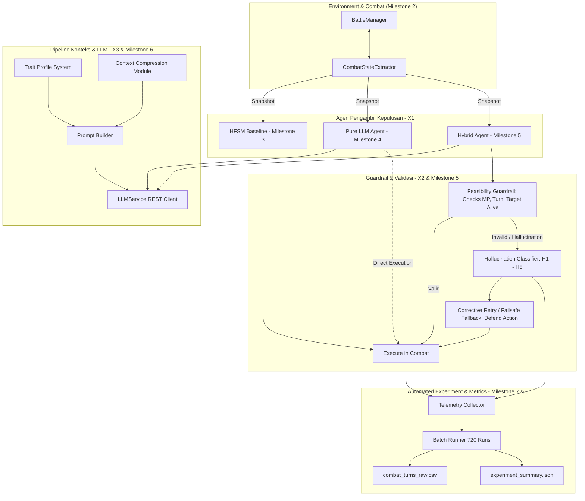

# Master Implementation Plan: Prototipe Sistem Decision-Making NPC Berbasis LLM & Hybrid FSM

**Penulis:** Omar Ginza (NRP: 5224600063)  
**Mata Kuliah:** Metodologi Penelitian (GT12C)  
**Judul Penelitian:** Desain Sistem Decision Making Agen Non-Playable Character Berbasis Large Language Model pada Game  
**Status Proyek:** Seluruh Dokumen Perencanaan Milestone Selesai (Menunggu persetujuan pengguna sebelum implementasi kode C# di Unity)

---

## 1. Daftar Dokumen Perencanaan Lengkap per Milestone

Seluruh detail teknis, arsitektur kelas, pipeline data, dan formula matematis telah didokumentasikan secara komprehensif pada folder [`implementation plan/`](file:///c:/Ginza/Github/Metodologi-Penelitian/implementation%20plan/):

| Milestone | Topik & Modul | Dokumen Spesifikasi Teknis | Status |
| :---: | :--- | :--- | :---: |
| **M0-GDD** | Game Design Document & Post-Apocalyptic Worldbuilding | [**`game_design_document_gdd.md`**](file:///c:/Ginza/Github/Metodologi-Penelitian/implementation%20plan/game_design_document_gdd.md) | Selesai Diimplementasikan |
| **M1** | Master Architecture & Variable Alignment | [**`master_implementation_plan.md`**](file:///c:/Ginza/Github/Metodologi-Penelitian/implementation%20plan/master_implementation_plan.md) | Selesai |
| **M2** | Core Combat Engine & State Extractor | [**`core_combat_and_extractor.md`**](file:///c:/Ginza/Github/Metodologi-Penelitian/implementation%20plan/core_combat_and_extractor.md) | Selesai Diimplementasikan |
| **M2-Ext1** | Human & Psychological Action Expansion | [**`expressive_actions_and_skills_expansion.md`**](file:///c:/Ginza/Github/Metodologi-Penelitian/implementation%20plan/expressive_actions_and_skills_expansion.md) | Selesai Diimplementasikan |
| **M2-Ext2** | Psychological Morale & Relationship System | [**`psychological_morale_and_relationship_system.md`**](file:///c:/Ginza/Github/Metodologi-Penelitian/implementation%20plan/psychological_morale_and_relationship_system.md) | Selesai Diimplementasikan |
| **M2-Ext3** | Trait Evolution & Tactical Command System | [**`trait_evolution_and_tactical_command_system.md`**](file:///c:/Ginza/Github/Metodologi-Penelitian/implementation%20plan/trait_evolution_and_tactical_command_system.md) | Selesai Diimplementasikan |
| **M3** | Baseline HFSM Agent Architecture | [**`hfsm_agent_architecture.md`**](file:///c:/Ginza/Github/Metodologi-Penelitian/implementation%20plan/hfsm_agent_architecture.md) | Siap Diimplementasikan |
| **M4** | LLM Service & Pure LLM Agent | [**`milestone_4_llm_service_and_pure_llm.md`**](file:///c:/Ginza/Github/Metodologi-Penelitian/implementation%20plan/milestone_4_llm_service_and_pure_llm.md) | Selesai |
| **M5** | Action Validator & Hybrid Agent Controller | [**`milestone_5_action_validator_and_hybrid_agent.md`**](file:///c:/Ginza/Github/Metodologi-Penelitian/implementation%20plan/milestone_5_action_validator_and_hybrid_agent.md) | Selesai |
| **M6** | Trait System & Context Compression | [**`milestone_6_trait_system_and_context_compression.md`**](file:///c:/Ginza/Github/Metodologi-Penelitian/implementation%20plan/milestone_6_trait_system_and_context_compression.md) | Selesai |
| **M7** | Automated Batch Simulation & Telemetry | [**`milestone_7_batch_experiment_runner_and_telemetry.md`**](file:///c:/Ginza/Github/Metodologi-Penelitian/implementation%20plan/milestone_7_batch_experiment_runner_and_telemetry.md) | Selesai |
| **M8** | Pilot Testing & Data Validation Protocol | [**`milestone_8_pilot_testing_and_data_validation.md`**](file:///c:/Ginza/Github/Metodologi-Penelitian/implementation%20plan/milestone_8_pilot_testing_and_data_validation.md) | Selesai |

---

## 2. Pemetaan Variabel Penelitian ke Seluruh Milestone

```
+--------------------------------------------------------------------------------------------------+
|                                    VARIABEL PENELITIAN & MILESTONES                              |
+--------------------------------------------------------------------------------------------------+
| Variabel Bebas (X):                                                                              |
|   X1: Tipe Agen NPC (HFSM Murni, Pure LLM, Hybrid LLM+HFSM)       -> Milestone 2, 3, 4, 5        |
|   X2: Pembatasan Validator FSM (Tanpa vs Dengan Guardrail)         -> Milestone 5 (ActionVal)     |
|   X3: Kompresi Konteks (Tanpa vs Dengan Kompresi Semantik)         -> Milestone 6 (Compressor)    |
|                                                                                                  |
| Variabel Terikat (Y):                                                                            |
|   Y1: Response Diversity (Normalized Shannon Entropy)              -> Milestone 7 (MetricsCalc)   |
|   Y2: Illogical Decision Rate (%) & Taksonomi Halusinasi (H1 - H5) -> Milestone 5 (Classifier)    |
|   Y3: Trait Consistency Score (Frozen Ground-Truth Matrix)         -> Milestone 6 (TraitSystem)   |
|   Y4: Decision Coherence (Unjustified Reversal Rate)               -> Milestone 6 (Coherence)     |
|   Y5: Human Plausibility Rating (Likert 1-5 Blinded Evaluation)    -> Milestone 7 (BlindedExport) |
|   Y6: Efisiensi Token (Input/Output Tokens & Compression Ratio)    -> Milestone 4, 6 (Telemetry)  |
|   Y7: Latensi Keputusan (Waktu Inferensi + Validasi dalam ms)      -> Milestone 4, 5, 7           |
+--------------------------------------------------------------------------------------------------+
```

---

## 3. High-Level System Architecture



---

## 4. Instruksi Pengendalian Eksekusi

> [!IMPORTANT]
> Seluruh kode program Unity C# (`Assets/Scripts/...`) **TIDAK AKAN DIBUAT ATAU DIUBAH** sampai ada perintah eksplisit (*"Proceed"* / *"Mulai implementasi"*) dari pengguna. Dokumen ini menjadi cetak biru (*blueprint*) acuan saat implementasi disetujui.
