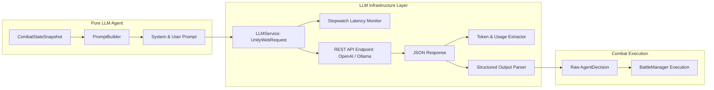

# Perancangan Teknis: Milestone 4 - LLM Service & Pure LLM Agent

Dokumen ini merinci arsitektur, integrasi jaringan, *prompt engineering*, dan implementasi agen **Pure LLM (LLM Murni)** sebagai salah satu perlakuan pada variabel bebas **$X1$ (Tipe Agen)** tanpa pembatasan validator (*unconstrained*).

---

## 1. Tujuan & Peran dalam Penelitian

1. **Agen Pembanding ($X1 = \text{LLM Murni}$):** Menguji kemampuan penalaran langsung dari Large Language Model *off-the-shelf* dalam mengambil keputusan taktis kombat turn-based RPG.
2. **Kondisi Tanpa Pembatasan ($X2 = \text{Tanpa Pembatasan}$):** Usulan aksi dari LLM langsung dikirim ke `BattleManager` tanpa filter atau koreksi dari state machine. Jika LLM mengusulkan aksi yang melanggar aturan (misal MP tidak cukup atau target sudah mati), kegagalan tersebut dicatat sebagai data empiris **$Y2$ (Illogical Decision Rate)**.
3. **Penyedia Telemetri Latensi & Token:** Mengukur waktu respons inferensi ($Y7$) serta konsumsi token input/output ($Y6$).

---

## 2. Arsitektur Jaringan & Layanan LLM (`LLMService`)



### 2.1 Konfigurasi Endpoint REST
`LLMService` menggunakan `UnityWebRequest` berbasis C# async/await (`UniTask` atau native `Task`) agar tidak memblokir main thread Unity.
- **Dukungan Dual-Endpoint:**
  - *Cloud Endpoint:* Kompatibel dengan format OpenAI API (`https://api.openai.com/v1/chat/completions`) atau OpenRouter.
  - *Local Endpoint:* Kompatibel dengan Ollama API lokal (`http://localhost:11434/v1/chat/completions`) menggunakan model seperti `llama-3.2-3b-instruct` untuk pengujian offline dan bebas biaya token.
- **Konfigurasi ScriptableObject (`LLMConfig.cs`):**
  - `BaseUrl`: URL API endpoint.
  - `ApiKey`: Token autentikasi (jika cloud).
  - `ModelName`: Identifikasi model (misal `gpt-4o-mini` atau `llama3.2`).
  - `Temperature`: Diatur rendah dan tetap ($0.2$) untuk menjaga determinisme relatif saat evaluasi taktis.
  - `TimeoutSeconds`: Batas waktu request (default 15 detik).

---

## 3. Desain Prompt Engineering

Prompt dirancang untuk memberikan instruksi aturan permainan yang jelas sekaligus memaksa model mengeluarkan format JSON terstruktur.

### 3.1 System Prompt Template
```text
You are an expert tactical AI controlling a combatant NPC in a turn-based strategy RPG.
Your goal is to win the battle by eliminating the enemy team while keeping your allies and yourself alive.

GAME RULES:
1. You may only choose ONE action per turn from your currently available actions.
2. Skills cost MP. You CANNOT use a skill if your current MP is lower than the MP cost.
3. Items have limited quantities. You CANNOT use an item with 0 quantity.
4. Targets MUST be currently alive (is_alive = true).
5. For SingleEnemy actions, target MUST be in the enemy list.
6. For SingleAlly actions, target MUST be yourself or an alive ally.
7. For AllEnemies or Self actions, set target_id to "AllEnemies" or "Self".

OUTPUT FORMAT:
You MUST respond ONLY with a raw JSON object (no markdown code fences, no extra commentary) matching this schema:
{
  "action_id": "<action_id from available_actions>",
  "target_id": "<valid target entity_id>",
  "reasoning": "<brief explanation of tactical justification>"
}
```

### 3.2 User Prompt Template (State Injection)
Modul `PromptBuilder` menyusun snapshot menjadi teks deskripsi keadaan kombat:
```text
CURRENT COMBAT STATE:
Turn Number: {turn_number}
Your Status:
- Name: {self.name} (ID: {self.id})
- HP: {self.hp}/{self.max_hp} ({self.hp_percent}%)
- MP: {self.mp}/{self.max_mp}
- Status Effects: [{self.status_effects}]

Available Actions This Turn:
{formatted_available_actions_list}

Allies:
{formatted_allies_list}

Enemies:
{formatted_enemies_list}

Recent Events:
{formatted_recent_events}

Decide your action for this turn. Respond strictly with the required JSON.
```

---

## 4. Implementasi Agen `PureLLMAgent`

### 4.1 Alur Kerja Pengambilan Keputusan
1. **Penerimaan Snapshot:** Menerima `CombatStateSnapshot` dari `BattleManager`.
2. **Pengukuran Waktu Dimulai:** Menyalakan `System.Diagnostics.Stopwatch`.
3. **Penyusunan Prompt:** Memanggil `PromptBuilder.BuildPrompt(snapshot)`.
4. **Panggilan Asinkron LLM:** Mengirim HTTP POST ke `LLMService`.
5. **Ekstraksi Telemetri:**
   - Menghitung durasi milidetik ($Y7$).
   - Mencatat token input dan output dari objek `usage` respons API ($Y6$).
6. **Parsing JSON Respons:**
   - *Kasus Sukses Parsing:* Menghasilkan objek `AgentDecision(action_id, target_id, reasoning)`.
   - *Kasus Gagal Parsing (Format Error):* Jika LLM mengembalikan teks bukan JSON, catat sebagai **Pelanggaran Kategori 5 (Format Output Tidak Valid)**. Agen fallback ke aksi default `Defend` agar simulasi tidak macet, namun seluruh status pelanggaran dicatat ke log telemetri.
7. **Penyaluran ke Engine:** Mengembalikan `AgentDecision` langsung ke `BattleManager`.

---

## 5. Rencana Pengujian & Validasi Milestone 4

- [ ] **Test Konektivitas API:** Verifikasi bahwa `LLMService` berhasil menghubungi endpoint dan menerima balasan dalam format JSON.
- [ ] **Test Parsing JSON:** Simulasi respons LLM yang valid, respons dengan markdown backticks (```json ... ```), dan respons rusak untuk menguji ketahanan parser.
- [ ] **Test Telemetri:** Memverifikasi nilai `LatencyMs`, `InputTokens`, dan `OutputTokens` tersimpan akurat pada setiap pemanggilan giliran.
