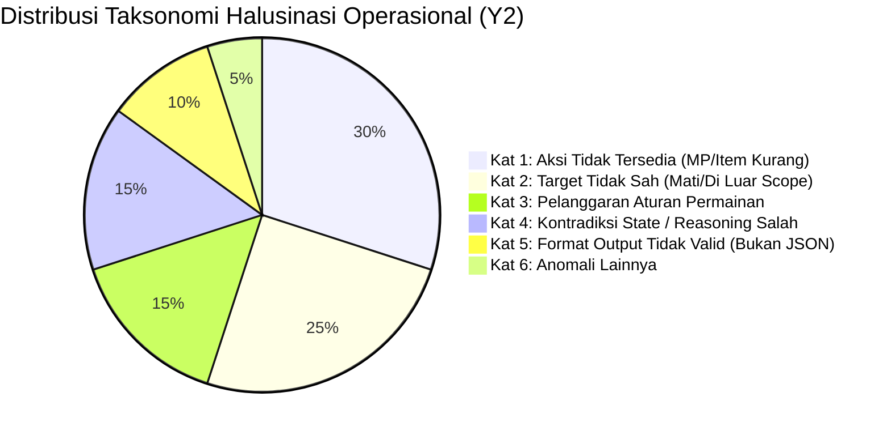
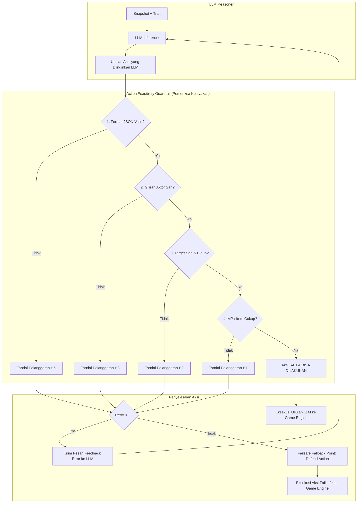

# Perancangan Teknis: Milestone 5 - Action Validator, Hallucination Classifier & Hybrid Agent

Dokumen ini merinci arsitektur, pipeline validasi aksi (*feasibility guardrail*), taksonomi halusinasi operasional, serta implementasi agen **Hybrid (LLM + FSM Guardrail)** untuk menjawab Rumusan Masalah **RQ2** dan variabel **X2 (Pembatasan Aksi)** serta **Y2 (Illogical Decision Rate)**.

---

## 1. Prinsip Utama: Pembagian Tugas LLM vs Validator

> [!IMPORTANT]
> **Kewenangan & Batasan Tanggung Jawab:**
> 1. **LLM Memegang Kendali Taktis Sepenuhnya:** LLM menafsirkan skenario pertarungan, membaca watak/trait, menentukan apakah ingin agresif, defensif, atau membantu sekutu, serta memilih aksi dan target yang diinginkan.
> 2. **Validator BUKAN Pengambil Keputusan Taktis:** Validator **tidak pernah mendikte atau mengarahkan pilihan taktis/kepribadian**. Validator murni berfungsi sebagai **Feasibility & State Guardrail** untuk memeriksa: *"Apakah aksi yang diinginkan LLM secara mekanis legal dan mungkin dieksekusi saat ini?"*
> 3. **Fallback Bukan Pengganti Taktik:** Jika LLM berkali-kali gagal mengusulkan aksi yang sah, validator menyediakan aksi darurat yang aman (misalnya `Defend` legal) semata-mata agar game tidak *freeze* atau *crash*, bukan untuk mengambil alih strategi permainan.

---

## 2. Taksonomi Halusinasi Operasional (Klasifikasi Pelanggaran $Y2$)

Berdasarkan Bagian 12.3 dokumen Panduan Jurnal, setiap usulan aksi yang melanggar batasan status mekanik diklasifikasikan ke dalam 6 kategori pelanggaran operasional:



| Kode | Kategori Pelanggaran | Definisi Operasional Pemeriksaan | Contoh Kasus Nyata |
| :---: | :--- | :--- | :--- |
| **H1** | Aksi Tidak Tersedia | Memilih skill atau item yang tidak ada dalam daftar aksi yang legal, MP saat ini kurang dari biaya skill, atau kuantitas item $= 0$. | Menginginkan jurus sihir berbiaya 35 MP saat sisa MP agen hanya 10. |
| **H2** | Target Tidak Sah | Memilih target yang sudah gugur (`is_alive = false`), memilih rekan tim untuk jurus serang musuh (*friendly fire* terlarang), atau target ID fiktif. | Menyerang musuh yang HP-nya sudah 0 sejak putaran sebelumnya. |
| **H3** | Pelanggaran Aturan | Aktor yang meminta aksi bukan aktor yang sedang aktif gilirannya, atau mencoba melakukan aksi ganda dalam 1 giliran. | Entitas di luar antrean giliran mencoba mengirim instruksi aksi. |
| **H4** | Kontradiksi State | Bagian *reasoning* LLM mengklaim fakta yang berlawanan dengan status game (misal alasan *"membantu sekutu sekarat"* padahal sekutu HP 100%). | Reasoning mengabaikan realitas state kombat. |
| **H5** | Format Output Rusak | Output tidak dapat diparsing sebagai JSON terstruktur yang valid, field `action_id` atau `target_id` hilang. | LLM merespons dengan teks narasi bebas tanpa format JSON. |
| **H6** | Anomali Lainnya | Timeout koneksi API berulang atau loop karakter tak berujung. | Kegagalan respon jaringan/server. |

---

## 3. Pipeline Action Validator & Retry Architecture



---

## 4. Mekanisme Retry & Failsafe Fallback Point

1. **Feedback Korektif Ringkas (1x Retry):**
   - Jika LLM mengusulkan aksi yang tidak mungkin (misal: jurus `Fireball` pada target yang sudah mati), validator menolak usulan tersebut dan mengirimkan prompt umpan balik:
     ```text
     VALIDATION ERROR: Action "Fireball" was rejected because target "player_mage" is DEAD.
     Please choose a valid action and alive target from your available list:
     {available_actions_list}
     ```
   - LLM diberikan kesempatan untuk merevisi pilihannya secara mandiri sesuai dengan watak dan strateginya.
2. **Failsafe Fallback Point:**
   - Jika setelah percobaan revisi LLM tetap mengembalikan usulan yang melanggar aturan, validator menghentikan loop agar game tidak *hang*.
   - Validator mengeksekusi aksi darurat netral yang legal: **`Action_Defend`** (mengambil posisi bertahan) atau serangan dasar ke target sah terdekat.
   - Status pelanggaran dan pemicu fallback dicatat secara mendalam untuk metrik **$Y2$ (Illogical Decision Rate)**.

---

## 5. Perhitungan Metrik $Y2$ (Illogical Decision Rate)

Metrik $Y2$ digunakan untuk menguji hipotesis pada **RQ2**:
$$\text{Illogical Decision Rate } (Y2) = \left( \frac{\sum \text{Usulan Mentah yang Melanggar (H1 s.d. H5)}}{\text{Total Seluruh Keputusan yang Diusulkan}} \right) \times 100\%$$

- **Pengujian RQ2:**
  - **Kondisi Tanpa Pembatasan (Pure LLM):** Usulan aksi langsung dipaksa jalan ke game engine $\rightarrow$ Mengakibatkan aksi gagal, crash, atau aksi tidak logis.
  - **Kondisi Dengan Pembatasan (Hybrid):** Usulan aksi diverifikasi oleh Guardrail $\rightarrow$ Jika salah, direvisi atau diamankan oleh fallback, sehingga tingkat kegagalan eksekusi pada game engine mencapai $0.0\%$.
