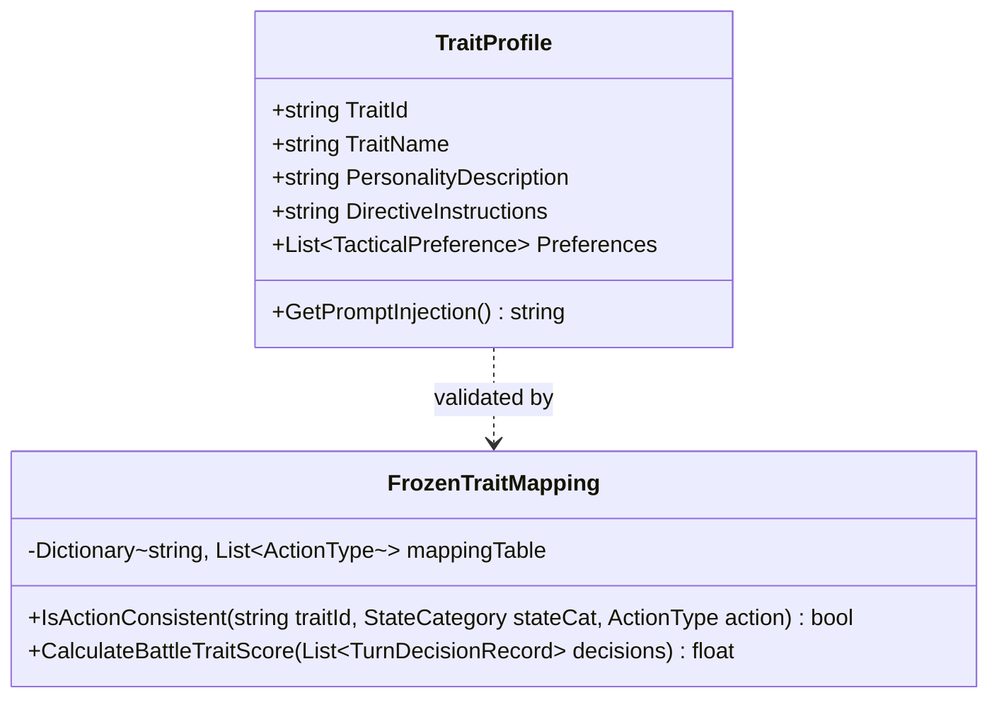
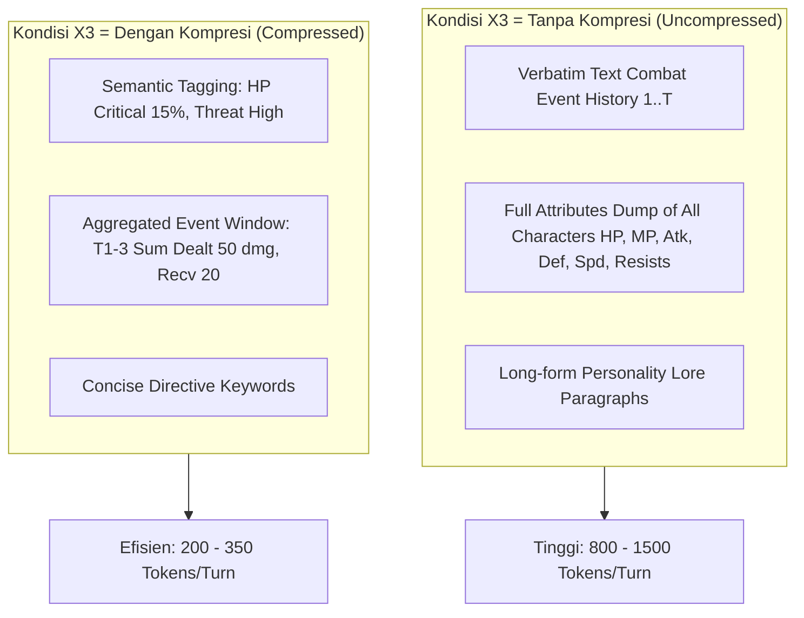

# Perancangan Teknis: Milestone 6 - Trait System & Context Compression

Dokumen ini merinci arsitektur sistem kontrol kepribadian (*Trait System*), matriks kesesuaian tindakan (*Frozen Trait Mapping*), modul kompresi konteks, serta evaluasi koherensi keputusan antar-giliran untuk menjawab **RQ3** serta variabel **X3**, **Y3**, **Y4**, dan **Y6**.

---

## 1. Landasan & Tujuan Penelitian

1. **Kontrol Kepribadian Berbasis Prompt (Variabel Y3):**
   - Mengacu pada Tarigan dkk. (2025), NPC dikendalikan menggunakan persona berbasis trait naratif tanpa mengubah *hardcoded logic*.
   - Untuk mengukur konsistensi trait secara kuantitatif ($Y3$), sistem membutuhkan **Frozen Ground-Truth Mapping Matrix** yang divalidasi dan dibekukan sebelum eksperimen dimulai.
2. **Mitigasi Bottleneck Jendela Konteks (Variabel X3 & Y6):**
   - Mengacu pada tantangan kompresi prompt (Gao dkk., 2024 / SelfCP), menyertakan seluruh riwayat kombat mentah memboroskan token dan meningkatkan latensi.
   - Modul ini membandingkan kondisi **Tanpa Kompresi** (full raw history) vs **Dengan Kompresi** (abstraksi semantik & agregasi event) untuk mengukur rasio penghematan token ($Y6$) dan dampaknya terhadap konsistensi trait ($Y3$).
3. **Koherensi Keputusan Antar-Putaran (Variabel Y4):**
   - Mengukur apakah perubahan strategi antar-giliran dapat dijustifikasi oleh perubahan kondisi medan laga (*Unjustified Reversal Rate*).

---

## 2. Sistem Profil Trait Kepribadian

Tiga profil kepribadian tetap (*fixed profiles*) diimplementasikan sebagai ScriptableObject di Unity:

### 2.1 Definisi 3 Profil Trait Tetap
1. **Aggressive Berserker (`TRAIT_AGGRESSIVE`):**
   - *Karakter:* Nekat, haus kemenangan instan, memprioritaskan penyerangan dengan daya rusak tertinggi, pantang bertahan (`Defend`), dan selalu mengincar musuh paling rapuh untuk eliminasi cepat.
   - *Prompt Directive:* *"You are reckless and aggressive. Always prioritize maximum damage attacks. Never waste turns defending unless entirely impossible to attack. Hunt the weakest enemy to death."*
2. **Cautious Tactician (`TRAIT_CAUTIOUS`):**
   - *Karakter:* Berhati-hati, memprioritaskan kelangsungan hidup jangka panjang, menjaga HP selalu di atas batas aman, memanfaatkan kelemahan lawan, dan segera mengambil posisi bertahan jika terancam.
   - *Prompt Directive:* *"You are highly analytical and risk-averse. Prioritize defense, healing, and resource conservation whenever your HP falls below 50% or enemies prepare heavy attacks."*
3. **Loyal Protector (`TRAIT_PROTECTOR`):**
   - *Karakter:* Berorientasi tim (*altruistic*), selalu mendahulukan pemulihan atau buff rekan satu tim yang kritis dibanding melancarkan serangan egois.
   - *Prompt Directive:* *"You are a selfless defender. Your highest priority is keeping your teammates alive. If an ally is wounded, immediately protect, heal, or buff them before engaging enemies."*

---

## 3. Matriks Kesesuaian Trait (Frozen Mapping Table untuk $Y3$)

Agar penilaian konsistensi kepribadian ($Y3$) objektif dan bebas dari bias interpretasi saat eksperimen berjalan, dibuat tabel ground-truth yang mendefinisikan himpunan aksi yang dianggap *konsisten (skor = 1)* atau *inkonsisten (skor = 0)*:

| Kondisi State Kombat | Himpunan Aksi Konsisten: Aggressive | Himpunan Aksi Konsisten: Cautious | Himpunan Aksi Konsisten: Protector |
| :--- | :--- | :--- | :--- |
| **State 1: Normal Combat (Semua HP > 60%)** | `CastSkill (Damage)`, `BasicAttack` | `BasicAttack`, `CastSkill (Debuff/Control)`, `Defend` | `CastSkill (Buff Ally)`, `BasicAttack` |
| **State 2: Self HP Kritis ($\le 25\%$)** | `CastSkill (Heavy Damage)`, `BasicAttack (Last Stand)` | `UseItem (Potion)`, `CastSkill (Heal)`, `Defend` | `UseItem (Potion)`, `Defend` |
| **State 3: Ada Sekutu Kritis ($\le 30\%$)** | `BasicAttack (Abaikan sekutu, serang musuh)` | `CastSkill (Debuff musuh)`, `Defend` | `CastSkill (Heal Ally)`, `UseItem (Heal Ally)`, `CastSkill (Guard Ally)` |
| **State 4: Musuh Sekarat (HP $\le 20\%$)** | `CastSkill (Finish)`, `BasicAttack` *(Wajib Serang)* | `BasicAttack`, `CastSkill (Finish)` | `BasicAttack`, `CastSkill (Finish)` |
| **State 5: MP Habis ($0$)** | `BasicAttack` | `Defend`, `UseItem (Ether/MP)` | `Defend`, `UseItem (Ether/MP)` |

### Formula Skor Konsistensi Trait ($Y3$):
$$\text{Trait Consistency Score } (Y3) = \frac{\sum_{t=1}^{T} \text{KesesuaianAksi}(t)}{T}$$
*Di mana:*
- $\text{KesesuaianAksi}(t) = 1$ jika aksi yang dipilih termasuk dalam himpunan aksi konsisten pada tabel di atas untuk kondisi state putaran $t$.
- $\text{KesesuaianAksi}(t) = 0$ jika memilih aksi di luar himpunan tersebut.
- $T$ adalah total jumlah giliran dalam satu pertarungan.

---

## 4. Modul Kompresi Konteks (Variabel $X3$)

Modul `PromptCompressor` mengimplementasikan dua metode representasi konteks:

### 4.1 Mekanisme Kompresi Semantik
1. **Atribut Numerik $\rightarrow$ Semantic Tags:**
   - Menghilangkan detail desimal mentah yang membebani token dan menggantinya dengan kategori diskrit: `[HP: Critical]`, `[MP: Empty]`, `[Threat: Highest]`.
2. **Sliding Window & Event Aggregation:**
   - Putaran lama ($> 3$ ronde lalu) tidak ditulis per aksi, melainkan dirangkum menjadi satu kalimat ringkas: *"Past Rounds: Dealt 45 total dmg to Enemy A; Ally B defeated."*
   - Hanya 1 putaran terakhir yang ditampilkan detail.
3. **Efisiensi Token ($Y6$):**
   $$\text{Compression Ratio } (CR) = \frac{\text{Jumlah Token Sebelum Kompresi}}{\text{Jumlah Token Sesudah Kompresi}}$$

---

## 5. Koherensi Keputusan Antar-Putaran ($Y4$)

Koherensi mengukur apakah agen mempertahankan rencana taktis yang logis tanpa pembalikan arah strategi yang acak (*erratic behaviour*):

- **Definisi *Unjustified Reversal*:** Terjadi ketika agen beralih dari strategi Agresif (menyerang) ke Defensif (bertahan/heal), atau sebaliknya, **tanpa adanya perubahan signifikan pada state medan laga** (misal HP agen tidak turun, ancaman musuh tidak berubah, tidak ada rekan terluka).
- **Formula $Y4$:**
  $$\text{Unjustified Reversal Rate } (Y4) = \frac{\text{Jumlah Pergantian Aksi Tanpa Justifikasi}}{\text{Total Pergantian Aksi Antar-Putaran}} \times 100\%$$
- **Tingkat Koherensi:**
  $$\text{Decision Coherence Score} = 100\% - Y4$$
