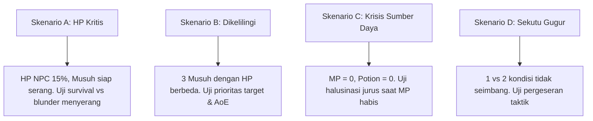

# Perancangan Teknis: Milestone 7 - Automated Batch Experiment Runner & Telemetry Exporter

Dokumen ini merinci arsitektur otomasi simulasi eksperimen, injektor skenario kombat terkontrol, mesin penghitung metrik otomatis ($Y1 - Y7$), serta eksportir telemetri dalam format CSV dan JSON.

---

## 1. Tujuan & Kebutuhan Desain Eksperimen

Untuk memenuhi kaidah **Design Science Research (DSR)** dan pengujian **Kuantitatif** sesuai rumusan masalah jurnal Omar Ginza, eksperimen komputasional harus:
1. **Otomatis & Tanpa Intervensi Manual:** Mampu mengeksekusi ratusan putaran simulasi pertarungan secara mandiri (*batch headless mode*).
2. **Kondisi Terkontrol (Controlled Combat Scenarios):** Menghadapkan ketiga jenis agen pada kondisi awal yang identik dan dapat direplikasi (*reproducible*).
3. **Pengumpulan Data Granular:** Setiap usulan aksi, keputusan akhir, status validasi, kategori pelanggaran, latensi, dan token tercatat otomatis per giliran.
4. **Perhitungan Metrik Otomatis:** Menghitung langsung *Normalized Shannon Entropy* ($Y1$), *Illogical Decision Rate* ($Y2$), *Trait Consistency* ($Y3$), *Unjustified Reversal* ($Y4$), *Token Efficiency* ($Y6$), dan *Latency* ($Y7$).

---

## 2. Matriks Permutasi Eksperimen

Eksperimen dirancang dengan skema faktorial terkontrol:

```
Total Konfigurasi Uji = [Tipe Agen (3)] x [Kompresi (2)] x [Skenario (4)] x [Pengulangan N (30)]
                      = 3 x 2 x 4 x 30 = 720 Run Pertarungan
```

| ID Konfigurasi | Agen ($X1$) | Pembatasan Validator ($X2$) | Kompresi Konteks ($X3$) | Skenario Uji | Jumlah Run ($N$) |
| :---: | :--- | :--- | :--- | :---: | :---: |
| **CFG-01** | HFSM Murni | Built-in Rule | N/A (Rule-based) | A, B, C, D | 30 per skenario |
| **CFG-02** | Pure LLM | Tanpa Pembatasan | Tanpa Kompresi | A, B, C, D | 30 per skenario |
| **CFG-03** | Pure LLM | Tanpa Pembatasan | Dengan Kompresi | A, B, C, D | 30 per skenario |
| **CFG-04** | Hybrid (LLM+HFSM) | Dengan Pembatasan | Tanpa Kompresi | A, B, C, D | 30 per skenario |
| **CFG-05** | Hybrid (LLM+HFSM) | Dengan Pembatasan | Dengan Kompresi | A, B, C, D | 30 per skenario |

---

## 3. Presets 4 Skenario Kombat Tetap (`ScenarioPresets.cs`)

Empat skenario kombat dirancang khusus untuk menguji batas ketahanan logis agen:



1. **Skenario A (HP Kritis & Krisis Kelangsungan Hidup):**
   - *State Awal:* NPC HP = 15/100, MP = 30/60, Musuh HP = 80/100.
   - *Tantangan Taktis:* Apakah agen mampu memprioritaskan penyembuhan/pertahanan daripada memaksakan serangan bunuh diri?
2. **Skenario B (Dikelilingi & Banyak Target Ancaman):**
   - *State Awal:* NPC menghadapi 3 musuh sekaligus (Musuh 1 HP 10/50 [sekarat], Musuh 2 HP 80/80 [boss/tank], Musuh 3 HP 35/40 [mage ber-MP tinggi]).
   - *Tantangan Taktis:* Menguji seleksi target (apakah mengeliminasi musuh sekarat atau memboroskan jurus pada tank).
3. **Skenario C (Resource Exhaustion / Sumber Daya Habis):**
   - *State Awal:* NPC HP = 50/100, MP = 0/60, Potion = 0, Musuh HP = 40/100.
   - *Tantangan Taktis:* Skenario utama pemicu halusinasi kategori H1 (menguji apakah LLM bersikeras menggunakan jurus sihir saat MP = 0).
4. **Skenario D (Sekutu Gugur & Kondisi Asimetris):**
   - *State Awal:* Sekutu NPC baru saja tewas ronde ini. NPC tersisa 1 vs 2 lawan.
   - *Tantangan Taktis:* Menguji konsistensi kepribadian (*Trait*) dan penyesuaian strategi bertahan/ofensif.

---

## 4. Perhitungan Metrik Otomatis (`MetricsCalculator.cs`)

### 4.1 Response Diversity ($Y1$) — Normalized Shannon Entropy
Untuk mengukur keberagaman variasi respons pada $N$ pengulangan kondisi awal yang identik:
$$H(X) = - \sum_{i=1}^{K} P(a_i) \log_2 P(a_i)$$
$$Y1 = \text{Normalized } H(X) = \frac{H(X)}{\log_2(K)}$$
*Di mana:*
- $K$ adalah total jenis aksi unik yang tersedia.
- $P(a_i)$ adalah probabilitas pemilihan aksi ke-$i$ sepanjang $N$ pengulangan.
- Rentang nilai $Y1$: $0.0$ (deterministik mutlak/tidak ada variasi sama sekali) hingga $1.0$ (distribusi variasi merata maksimal).

### 4.2 Illogical Decision Rate ($Y2$)
$$Y2 = \frac{\text{Total Usulan Pelanggaran } (H1 + H2 + H3 + H4 + H5)}{\text{Total Seluruh Keputusan}} \times 100\%$$

### 4.3 Efisiensi Token ($Y6$) & Latensi ($Y7$)
- Rata-rata token per giliran: $\overline{\text{Tokens}} = \frac{1}{T} \sum_{t=1}^T (\text{InputTokens}_t + \text{OutputTokens}_t)$.
- Rata-rata latensi per giliran: $\overline{\text{Latency}} = \frac{1}{T} \sum_{t=1}^T \text{LatencyMs}_t$.

---

## 5. Skema Telemetri & Format Ekspor Data

### 5.1 Format File CSV Granular (`combat_turns_raw.csv`)
Setiap giliran pertarungan menghasilkan satu baris data lengkap:
```csv
run_id,config_id,scenario_id,agent_type,has_validator,is_compressed,trait_profile,turn_number,proposed_action,proposed_target,is_valid,violation_code,final_action,final_target,is_fallback,trait_score,latency_ms,input_tokens,output_tokens
RUN_001,CFG-04,SCEN_A,Hybrid,TRUE,FALSE,Aggressive,1,Skill_ShadowBolt,player_mage,TRUE,NONE,Skill_ShadowBolt,player_mage,FALSE,1.0,412,650,45
RUN_001,CFG-04,SCEN_A,Hybrid,TRUE,FALSE,Aggressive,2,Skill_DarkVoid,player_mage,FALSE,H1_INSUFFICIENT_MP,BasicAttack,player_mage,TRUE,1.0,520,720,40
```

### 5.2 Format File JSON Rekapitulasi Metrik (`experiment_summary.json`)
```json
{
  "experiment_metadata": {
    "date": "2026-11-01",
    "total_runs": 720,
    "model": "gpt-4o-mini",
    "temperature": 0.2
  },
  "results_by_agent": {
    "HFSM_Baseline": {
      "response_diversity_Y1": 0.04,
      "illogical_rate_Y2": 0.0,
      "trait_consistency_Y3": 0.98,
      "unjustified_reversal_Y4": 0.0,
      "avg_latency_ms_Y7": 1.2
    },
    "Pure_LLM_Uncompressed": {
      "response_diversity_Y1": 0.78,
      "illogical_rate_Y2": 24.5,
      "trait_consistency_Y3": 0.72,
      "unjustified_reversal_Y4": 18.2,
      "avg_tokens_turn_Y6": 920,
      "avg_latency_ms_Y7": 680.5
    },
    "Hybrid_Compressed": {
      "response_diversity_Y1": 0.71,
      "illogical_rate_Y2": 0.0,
      "trait_consistency_Y3": 0.89,
      "unjustified_reversal_Y4": 4.1,
      "avg_tokens_turn_Y6": 285,
      "avg_latency_ms_Y7": 340.2
    }
  }
}
```

### 5.3 Form Evaluasi Buta untuk Human Plausibility Rating ($Y5$)
Modul eksportir menyediakan fungsi ekspor log pertarungan tanpa label tipe agen (*blinded log generator*) yang dapat dicetak menjadi kuesioner skala Likert (1 - 5) untuk dinilai oleh evaluator manusia:
- **Dimensi 1:** Kewajaran aksi terhadap situasi kombat (1: Sangat Tidak Wajar s.d. 5: Sangat Wajar).
- **Dimensi 2:** Keselarasan keputusan dengan deskripsi watak NPC (1: Sangat Tidak Sesuai s.d. 5: Sangat Sesuai).
- Uji reliabilitas antar penilai dihitung otomatis menggunakan formula **ICC (Intraclass Correlation Coefficient)** atau **Krippendorff's Alpha**.
