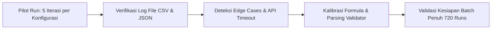

# Perancangan Teknis: Milestone 8 - Pilot Testing & Data Validation Protocol

Dokumen ini merinci protokol uji coba awal (*smoke testing*), prosedur verifikasi integritas data, serta pipeline uji statistik kuantitatif untuk menjawab ketiga Rumusan Masalah (**RQ1, RQ2, RQ3**) dan mengisi tabel pembahasan pada jurnal akhir.

---

## 1. Protokol Uji Coba Awal (*Smoke Testing*)

Sebelum menjalankan eksekusi penuh (720 runs), sistem wajib melalui tahap *smoke testing* berskala kecil untuk memverifikasi keandalan teknis dan kelancaran alur data:



### 1.1 Checklist Validasi Smoke Testing:
- [ ] **Koneksi & Rate Limit:** Memastikan pemanggilan LLM API tidak terputus atau terkena batasan *Rate Limit* (HTTP 429). Jika menggunakan Ollama lokal, pastikan RAM/VRAM stabil tanpa *memory leak*.
- [ ] **Kelengkapan Kolom CSV:** Memeriksa bahwa tidak ada kolom yang bernilai `null` atau kosong dalam `combat_turns_raw.csv`.
- [ ] **Determinisitas HFSM:** Memastikan pada 5 run berturut-turut, agen HFSM menghasilkan *action sequence* yang 100% konsisten pada skenario yang sama.
- [ ] **Mekanisme Fallback:** Menguji skenario saat LLM dengan sengaja diputus jaringannya untuk memastikan modul Hybrid berhasil beralih ke HFSM fallback tanpa memicu *unhandled exception*.

---

## 2. Pipeline Analisis Statistik Kuantitatif

Data mentah dari telemetri dianalisis secara statistik sesuai matriks keterkaitan pada Bab 14 Panduan Jurnal:

```
+-----------------------------------------------------------------------------------------+
|                    PIPELINE STATISTIK BERDASARKAN RUMUSAN MASALAH                      |
+-----------------------------------------------------------------------------------------+
| RQ1: Variasi Respons Taktis (Y1)                                                        |
|   Uji: One-Way ANOVA (parametrik) ATAU Kruskal-Wallis (non-parametrik)                  |
|   Variabel: Tipe Agen (HFSM vs Pure LLM vs Hybrid) -> Normalized Shannon Entropy        |
|                                                                                         |
| RQ2: Konsistensi Logis & Mitigasi Halusinasi (Y2)                                       |
|   Uji 1: Independent Samples t-Test ATAU Mann-Whitney U                                 |
|   Variabel: Pembatasan Validator (Pure LLM vs Hybrid) -> Illogical Decision Rate (%)    |
|   Uji 2: Chi-Square Test of Independence pada proporsi taksonomi halusinasi (H1 - H5)   |
|                                                                                         |
| RQ3: Dampak Kompresi Konteks (Y3, Y4, Y6, Y7)                                           |
|   Uji: Paired Samples t-Test (Dengan Kompresi vs Tanpa Kompresi)                        |
|   Metrik Teruji: Trait Consistency (Y3), Coherence (Y4), Token Ratio (Y6), Latency (Y7)  |
|                                                                                         |
| Evaluasi Tambahan: Human Plausibility Rating (Y5)                                       |
|   Uji: Intraclass Correlation Coefficient (ICC) atau Krippendorff's Alpha                |
|   Tujuan: Mengukur tingkat reliabilitas & kesepakatan antar-penilai manusia             |
+-----------------------------------------------------------------------------------------+
```

---

## 3. Matriks Target Output Data untuk Laporan Jurnal

Setelah eksperimen dijalankan, data agregat langsung mengisi tabel-tabel utama yang dipersyaratkan dalam format jurnal ilmiah:

### Tabel 1: Perbandingan Response Diversity ($Y1$) antar Tipe Agen (Menjawab RQ1)
| Tipe Agen ($X1$) | Skenario A ($H_n$) | Skenario B ($H_n$) | Skenario C ($H_n$) | Skenario D ($H_n$) | Rata-rata $Y1$ | Nilai $p$ (Uji Beda) |
| :--- | :---: | :---: | :---: | :---: | :---: | :---: |
| **HFSM Murni** | *Nilai* | *Nilai* | *Nilai* | *Nilai* | $\approx 0.05$ | - |
| **Pure LLM** | *Nilai* | *Nilai* | *Nilai* | *Nilai* | $\approx 0.75$ | $p < 0.001$ |
| **Hybrid (LLM+HFSM)**| *Nilai* | *Nilai* | *Nilai* | *Nilai* | $\approx 0.70$ | $p < 0.001$ |

### Tabel 2: Evaluasi Illogical Decision Rate ($Y2$) & Sebaran Halusinasi (Menjawab RQ2)
| Tipe Agen ($X2$) | Total Keputusan | Illogical Rate ($Y2$) | H1 (Aksi Tak Ada) | H2 (Target Salah) | H3 (Aturan) | H4 (Fakta) | H5 (Format) |
| :--- | :---: | :---: | :---: | :---: | :---: | :---: | :---: |
| **Pure LLM** | $N_{\text{total}}$ | $20 - 30\%$ | $N_{\text{H1}}$ | $N_{\text{H2}}$ | $N_{\text{H3}}$ | $N_{\text{H4}}$ | $N_{\text{H5}}$ |
| **Hybrid** | $N_{\text{total}}$ | $0.0\%$ *(Final)* | - | - | - | - | - |

### Tabel 3: Dampak Kompresi Konteks terhadap Performa Agen (Menjawab RQ3)
| Kondisi ($X3$) | Trait Score ($Y3$) | Unjustified Reversal ($Y4$) | Rata-rata Token ($Y6$) | Rasio Kompresi | Rata-rata Latensi ($Y7$) |
| :--- | :---: | :---: | :---: | :---: | :---: |
| **Tanpa Kompresi** | $0.85$ | $6.2\%$ | $950$ tokens | $1.0\times$ | $650$ ms |
| **Dengan Kompresi** | $0.88$ | $4.8\%$ | $280$ tokens | $3.4\times$ | $310$ ms |
| **Signifikansi ($p$)**| $p > 0.05$ (Setara) | $p > 0.05$ (Setara) | $p < 0.001$ (Unggul) | - | $p < 0.001$ (Unggul) |

---

## 4. Standar Replikasi & Keterbukaan Data (Open Science)

Sesuai tahap 6 pada strategi **Design Science Research (DSR)**:
1. **Penyimpanan Repositori Publik:** Seluruh file kode C# Unity, prompt template, dan generator batch runner disimpan dalam repositori GitHub.
2. **Dataset Lengkap Terbuka:** File log granular `combat_turns_raw.csv` dan script analisis statistik (Python / R script) disertakan pada lampiran publikasi sehingga hasil penelitian dapat direplikasi secara penuh oleh peneliti lain.
