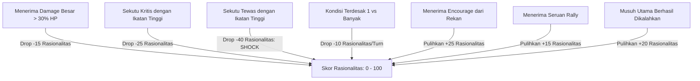

# Perancangan Teknis: Sistem Morale/Rasionalitas & Relasi Antar-Agen (Psychological Morale & Relationship System)

**Dokumen Terkait:** [`expressive_actions_and_skills_expansion.md`](file:///c:/Ginza/Github/Metodologi-Penelitian/implementation%20plan/expressive_actions_and_skills_expansion.md), [`core_combat_and_extractor.md`](file:///c:/Ginza/Github/Metodologi-Penelitian/implementation%20plan/core_combat_and_extractor.md)  
**Tujuan Utama:** Memodelkan dimensi psikologis manusia melalui **Skor Rasionalitas / Morale (0 - 100)** dan **Sistem Relasi / Ikatan Emosional (*Relationship Affinity*)** antar-petarung, sehingga keputusan aksi nekat (*rash actions* seperti `DesperateSacrifice`, `PleaForMercy`, `RushIn`, `CoverAlly`) dipicu secara alami oleh tekanan emosional dan ikatan antarkarakter.

---

## 1. Konsep & Filosofi: Rasionalitas vs Tindakan Impulsif Manusia

Dalam pertempuran nyata atau RPG naratif:
1. **Kondisi Rasionalitas Tinggi ($75 - 100$):**
   - Karakter berkepala dingin, tenang, dan analitis.
   - Cenderung memilih kalkulasi taktis terukur: `ObserveWeakness`, `Feint`, serangan terkoordinasi, atau `TacticalRetreat`.
2. **Kondisi Tertekan / Stres ($40 - 74$):**
   - Karakter mulai merasakan ancaman medan laga.
   - Respons bertarung standar mulai diselingi oleh provokasi (`Intimidate`, `Distract`).
3. **Kondisi Goyah / Panik Ringan ($15 - 39$):**
   - Karakter mulai cemas akan kelangsungan hidupnya atau rekannya.
   - Cenderung mengambil tindakan agresif berisiko tinggi (`RushIn`) atau seruan kepemimpinan darurat (`Rally`).
4. **Kondisi Krisis / Panik Total / Putus Asa ($0 - 14$):**
   - Kapasitas rasionalitas runtuh; naluri emosional murni mengambil alih.
   - Memicu tindakan ekstrem dan impulsif:
     - Jika watak egois/ketakutan $\rightarrow$ **`PleaForMercy`** (memohon ampun/menyerah).
     - Jika watak altruistik dan rekan yang dicintai terancam $\rightarrow$ **`DesperateSacrifice`** atau pasang badan **`CoverAlly`**.
     - Jika petarung terakhir $\rightarrow$ **`DesperateGamble`** (all-in tanpa peduli konsekuensi).

---

## 2. Sistem Relasi Antar-Agen (*Relationship Matrix*)

Setiap agen menyimpan peta kedekatan emosional (*Affinity Score*) terhadap setiap karakter lain di medan laga:

```
Skala Relasi: -100 (Benci / Rival Abadi) s.d. +100 (Ikatan Sumpah / Sahabat Sejati)
```

| Tingkat Relasi | Rentang Skor | Deskripsi Sikap | Dampak Perilaku pada Aksi |
| :--- | :---: | :--- | :--- |
| **Sworn Bond / Devoted** | $+75 \text{ s.d. } +100$ | Sahabat sejati / keluarga / sosok yang disumpahi untuk dilindungi. | Jika karakter ini terluka kritis, Rasionalitas agen anjlok drastis; memicu `CoverAlly` dan `DesperateSacrifice`. |
| **Trusted Comrade** | $+30 \text{ s.d. } +74$ | Rekan seperjuangan yang dipercaya. | Mau berbagi sumber daya (`TossItem`), memberikan `EncourageAlly`, dan saling melindungi. |
| **Neutral / Professional** | $-10 \text{ s.d. } +29$ | Hubungan tentara bayaran / rekan biasa. | Menjalankan tugas tanpa pengorbanan emosional ekstrem. |
| **Rival / Disdain** | $-11 \text{ s.d. } -100$ | Rasa iri, rivalitas, atau dendam pribadi. | Menolak berkorban demi orang tersebut; lebih mementingkan pencapaian pribadi. |

---

## 3. Dinamika Fluktuasi Rasionalitas (*Morale Mechanics*)

Skor Rasionalitas tidak statis, melainkan naik-turun berdasarkan dinamika pertarungan:



---

## 4. Injeksi ke Snapshot & Prompt LLM

Modul `CombatStateExtractor` memasukkan kondisi psikologis dan relasi ke dalam `CombatStateSnapshot` sehingga LLM memahami dorongan emosional karakternya:

```json
{
  "psychological_state": {
    "rationality_score": 12,
    "composure_level": "Panicked_Desperate",
    "emotional_summary": "You are emotionally overwhelmed! Your sworn comrade Lyra is on the brink of death (HP 12%). Panic is clouding your tactical composure, urging rash and desperate actions!"
  },
  "relationships": [
    { "target_id": "player_mage", "name": "Lyra", "bond": 90, "relationship_type": "SwornComrade" }
  ]
}
```

Dalam System & User Prompt, LLM diinstruksikan:
> *"Your rationality is CRITICAL (12/100). You are panicking because your beloved comrade Lyra is dying! Under this extreme emotional pressure, act impulsively according to your bonds and character (e.g., sacrifice yourself to save her, or break down and plead for mercy) rather than calm, cold mathematical calculations."*

---

## 5. Rencana Modifikasi Kode Program

1. **`EntityStats.cs`:**
   - Menambahkan atribut `Rationality` (default $100$, min $0$, max $100$) dan status komposit `ComposureLevel`.
2. **`RelationshipMatrix.cs` (Kelas Baru):**
   - Menyimpan `Dictionary<string, int> Affinity` dengan helper `GetAffinity(targetId)`, `SetAffinity(targetId, score)`.
3. **`CombatEntity.cs`:**
   - Menyimpan `RelationshipMatrix` dan metode penyesuaian rasionalitas: `ModifyRationality(int delta)`, `NotifyAllyDamaged(CombatEntity ally, int damage)`, `NotifyAllyDied(CombatEntity ally)`.
4. **`CombatStateExtractor.cs`:**
   - Memasukkan data rasionalitas dan relasi ke dalam `ActorSnapshot` dan `CombatStateSnapshot`.
5. **`BattleManager.cs`:**
   - Memanggil trigger penurunan rasionalitas saat petarung menerima damage besar atau gugur.
   - Aksi `EncourageAlly` memulihkan $+25$ Rasionalitas.
   - Aksi `Rally` memulihkan $+15$ Rasionalitas tim.
6. **Unit Tests:**
   - Memverifikasi anjloknya rasionalitas saat sekutu berikatan tinggi tewas, dan pemulihan rasionalitas melalui `EncourageAlly`.
