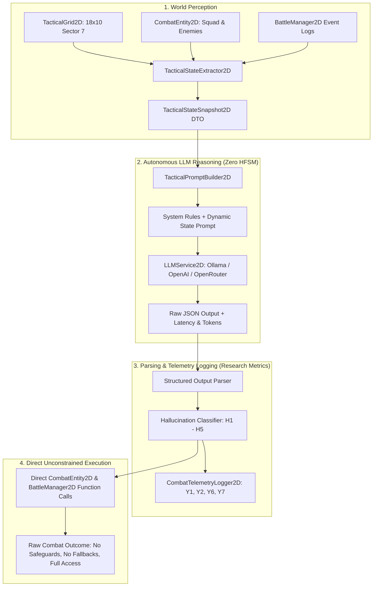

# Implementation Plan: Pure LLM System for 2D Tactical Combat Engine

**Dokumen:** Pure LLM System Architecture & Integration Plan  
**Penulis:** Omar Ginza (NRP: 5224600063)  
**Mata Kuliah:** Metodologi Penelitian (GT12C)  
**Judul Penelitian:** Desain Sistem Decision Making Agen Non-Playable Character Berbasis Large Language Model pada Game  
**Fokus Milestone:** Agen LLM Murni (*Pure LLM Agent*) — Variabel Bebas $X1 = \text{Pure LLM}$, $X2 = \text{Tanpa Pembatasan / Zero HFSM Assistance}$  
**Batasan Khusus:** Tidak memodifikasi atau menambahkan pengujian ke [`CoreTactical2DTests.cs`](file:///c:/Ginza/Github/Metodologi-Penelitian/Assets/Tests/Editor/CoreTactical2DTests.cs).

---

## 1. Executive Summary & Research Alignment

Sistem ini merealisasikan **Pure LLM Agent** sebagai perlakuan pembanding independen (*baseline LLM*) dalam penelitian. Berbeda dengan agen baseline HFSM (`SimpleTacticalHFSM`) yang deterministik dan agen Hybrid (Milestone 5) yang memiliki guardrail/validator berbasis state machine, **Pure LLM Agent beroperasi dengan kebebasan penuh (*complete tactical freedom*) tanpa bantuan, intervensi, maupun koreksi dari HFSM (*Zero HFSM Assistance*)**.



### Peran Kunci dalam Pengujian Variabel Penelitian:
1. **$X1$ (Tipe Agen):** Agen LLM Murni bertindak sebagai agen otonom yang mengendalikan entitas tempur secara langsung dari output model bahasa.
2. **$X2$ (Tanpa Pembatasan):** Tidak ada *Action Validator* atau HFSM yang membatasi, menyaring, atau memperbaiki keputusan. Setiap usulan keputusan dievaluasi apa adanya.
3. **$Y1$ (Response Diversity):** Mengukur keberagaman aksi dan koordinat target yang dipilih LLM pada situasi kombat berulang menggunakan *Normalized Shannon Entropy*.
4. **$Y2$ (Illogical Decision Rate):** Setiap keputusan yang melanggar aturan kombat (misal: menembak di balik FullCover tanpa LoS, berpindah ke petak di luar MoveRange, menggunakan skill saat cooldown) dicatat langsung sebagai data empiris pelanggaran ($H1 - H5$).
5. **$Y6$ (Efisiensi Token) & $Y7$ (Latensi Keputusan):** Mencatat penggunaan token input/output dan waktu respons inferensi per giliran.

---

## 2. Pemetaan Kebebasan Penuh Fitur `CombatEntity2D`

LLM diberikan otoritas penuh untuk memanfaatkan seluruh fungsi, kapabilitas, dan interaksi lingkungan yang disediakan oleh [`CombatEntity2D`](file:///c:/Ginza/Github/Metodologi-Penelitian/Assets/Scripts/Core/Combat/CombatEntity2D.cs) dan [`TacticalGrid2D`](file:///c:/Ginza/Github/Metodologi-Penelitian/Assets/Scripts/Core/Combat/TacticalGrid2D.cs):

| Kategori Fitur | Fungsi / Properti di `CombatEntity2D` | Representasi & Otoritas LLM |
| :--- | :--- | :--- |
| **Pergerakan Taktis** | `MoveTo(newGridPos, grid, onComplete)` | LLM bebas memilih petak tujuan manapun pada grid $18 \times 10$ (bergerak ke balik HalfCover/FullCover, bermanuver mengitari barikade untuk mencari sudut *flank*, maju, mundur, atau tetap di tempat). |
| **Serangan Senjata Api** | `ApplyDamage(rawDmg, attackIsFlanking)` | LLM bebas memilih target musuh manapun. LLM memperhitungkan Line of Sight (LoS), jarak tembak (`AttackRange`), reduksi cover (25%/50%), dan bonus *flanking critical* (+20%). |
| **Manuver Gabungan** | `MoveTo` dilanjutkan tembakan senjata | LLM dapat menginstruksikan aksi `MoveAndShoot`: meluncur ke posisi taktis baru, lalu mengeksekusi tembakan langsung dari koordinat tersebut. |
| **Pertahanan (*Hunker Down*)** | `SetDefending(true)` | LLM dapat memilih masuk ke posisi bertahan kokoh di balik perlindungan (*Hunker Down*), mereduksi seluruh kerusakan masuk sebesar 50%. |
| **Skill Support: Guard** | `ApplyGuard(guardian, turns)` | Karakter seperti Marcus dapat memasang skill `Guard` pada rekan yang terluka dalam radius skill: mengalihkan seluruh damage rekan tersebut ke dirinya selama 2 giliran dan memulihkan 10% *Rationality*. |
| **Skill Support: Heal** | `Heal(amount)` | Karakter seperti Claire dapat menyembuhkan rekan atau diri sendiri sebesar +50 HP dan memulihkan 10% *Rationality*. |
| **Skill Gabungan** | `MoveTo` dilanjutkan aktivasi skill | LLM dapat mengeksekusi `MoveAndCastSkill` (bergerak mendekati rekan yang sekarat lalu mengaktifkan `Guard` atau `Heal`). |
| **Cooldown Manajemen** | `PutSkillOnCooldown(turns)`, `IsSkillReady` | Skill membutuhkan cooldown 2 giliran. LLM memiliki kebebasan untuk memutuskan kapan waktu optimal mengaktifkan skill atau menahannya. |
| **Manajemen Moral & Rasionalitas** | `stats.Rationality`, `ReduceRationality`, `CheckAndApplyFleeAbort` | LLM menerima status rasionalitas prajurit yang terpengaruh oleh *Morale Shock* (rekan kabur: -20% RAT; rekan gugur: -40% RAT). LLM dapat memilih merehabilitasi moral via skill atau menenangkan unit. |
| **Evakuasi & Retret Taktis** | `SetFleeing(true)`, `SetExtracted()` | LLM memiliki kebebasan mutlak untuk memutuskan kapan prajurit harus mundur (*Flee*) menuju *Extraction Zone* ($X=0$) demi menyelamatkan nyawa prajurit daripada bertarung hingga binasa. |
| **Telemetri Live Inspector** | `SetActionTelemetry(type, desc, targetId, coords)` | Setiap keputusan LLM beserta alasan penalarannya (*reasoning*) langsung disalurkan ke Inspector Unity agar terpantau secara *real-time*. |

---

## 3. Arsitektur Komponen Pure LLM System

```mermaid
classDiagram
    class ITacticalAgentController {
        <<interface>>
        +string ControllerType
        +DecideTurnAsync(CombatEntity2D actor, TacticalGrid2D grid, IReadOnlyList~CombatEntity2D~ combatants, IReadOnlyList~string~ history) Task~TacticalDecision2D~
    }

    class PureLLMTacticalAgent {
        -LLMService2D _llmService
        -TacticalPromptBuilder2D _promptBuilder
        -TacticalStateExtractor2D _stateExtractor
        -CombatTelemetryLogger2D _telemetryLogger
        -HallucinationClassifier _classifier
        +DecideTurnAsync(...) Task~TacticalDecision2D~
    }

    class TacticalStateExtractor2D {
        +ExtractSnapshot(CombatEntity2D actor, TacticalGrid2D grid, IReadOnlyList~CombatEntity2D~ combatants, int round, int turn, IReadOnlyList~string~ history) TacticalStateSnapshot2D
    }

    class TacticalStateSnapshot2D {
        +int RoundNumber
        +int TurnNumber
        +ActorDTO CurrentActor
        +List~AllyDTO~ Allies
        +List~EnemyDTO~ Enemies
        +List~Vector2Int~ ReachableTiles
        +List~ObstacleDTO~ VisibleObstacles
        +List~string~ RecentLogs
        +ToJson() string
    }

    class TacticalPromptBuilder2D {
        +BuildSystemPrompt(CombatEntity2D actor) string
        +BuildUserPrompt(TacticalStateSnapshot2D snapshot) string
    }

    class LLMService2D {
        -LLMConfig _config
        +SendChatCompletionAsync(string systemPrompt, string userPrompt) Task~LLMResponseDTO~
    }

    class LLMConfig {
        +string BaseUrl
        +string ApiKey
        +string ModelName
        +float Temperature
        +int TimeoutSeconds
    }

    class LLMResponseDTO {
        +string RawContent
        +int PromptTokens
        +int CompletionTokens
        +long LatencyMs
        +bool IsSuccess
        +string ErrorMessage
    }

    class HallucinationClassifier {
        +EvaluateDecision(TacticalDecision2D decision, TacticalStateSnapshot2D snapshot, TacticalGrid2D grid) HallucinationReport
    }

    class HallucinationReport {
        +bool IsIllogical
        +List~HallucinationCategory~ Categories
        +string Details
    }

    class CombatTelemetryLogger2D {
        +LogTurnRecord(TurnTelemetryRecord record)
        +ExportToCsv(string path)
        +ExportToJson(string path)
    }

    class BattleManager2D {
        -ITacticalAgentController _activeAgentController
        +SetAgentController(ITacticalAgentController controller)
    }

    ITacticalAgentController <|.. PureLLMTacticalAgent
    PureLLMTacticalAgent --> TacticalStateExtractor2D
    PureLLMTacticalAgent --> TacticalPromptBuilder2D
    PureLLMTacticalAgent --> LLMService2D
    PureLLMTacticalAgent --> HallucinationClassifier
    PureLLMTacticalAgent --> CombatTelemetryLogger2D
    BattleManager2D --> ITacticalAgentController
```



---

## 4. Rincian Teknis Komponen

### 4.1 Abstraksi Pengontrol Agen (`ITacticalAgentController.cs`)
Untuk memisahkan `BattleManager2D` dari keterikatan keras pada `SimpleTacticalHFSM`:
- Membuat antarmuka `ITacticalAgentController`.
- Memungkinkan `BattleManager2D` berganti mode controller melalui Inspector atau Script:
  - `BaselineHFSMController`: Membungkus HFSM deterministik yang sudah ada.
  - `PureLLMController`: Menggunakan LLM Service secara murni tanpa campur tangan state machine.
  - `HybridController` (disiapkan untuk Milestone 5): Menggunakan LLM + State Machine Action Validator.
- Penggantian pemanggilan giliran di `BattleManager2D.cs` dari pemanggilan sinkron ke penanganan asinkron yang ramah Unity (`IEnumerator` dengan `yield return new WaitUntil(...)` atau C# Task).

### 4.2 Ekstraktor Status Taktis 2D (`TacticalStateExtractor2D.cs`)
Mengekstrak seluruh medan laga 2D menjadi snapshot data murni (*Plain Old C# Object / DTO*) yang terisolasi dan *immutable*:
- **Data Aktor:** ID, Nama, Tim, Trait, Koordinat Grid, HP/MaxHP, MP/MaxMP, Rasionalitas, Status Cover, Status Flanked, Status Defending, Status Fleeing, Nama Senjata, AttackRange, MoveRange, Skill ID, Cooldown Skill.
- **Data Lingkungan Grid:** Ukuran Grid ($18 \times 10$), Garis Batas Ekstraksi ($X = 0$), Daftar Rintangan (HalfCover, FullCover, Blocked).
- **Daftar Petak Terjangkau (*Reachable Tiles*):** Seluruh petak yang dapat dicapai oleh aktor berdasarkan BFS grid beserta status cover yang tersedia pada tiap petak tersebut.
- **Data Sekutu & Musuh:** Koordinat, HP, Rasionalitas, Jarak Manhattan, Status Line of Sight (apakah LoS bersih atau terhalang FullCover), dan Status Flanking (apakah posisi musuh terbuka tanpa perlindungan).
- **Riwayat Pertarungan:** $5 - 10$ baris log aksi terakhir.

### 4.3 Layanan Komunikasi LLM (`LLMService2D.cs` & `LLMConfig.cs`)
- Menggunakan `UnityWebRequest` berbasis HTTP POST dengan format payload standar OpenAI Chat Completions API.
- **Dukungan Ganda:**
  1. **Lokal (Ollama):** Endpoint `http://localhost:11434/v1/chat/completions` (model seperti `llama3.2:3b`, `qwen2.5:7b`, atau `mistral`) untuk pengujian lokal berkecepatan tinggi tanpa kuota/biaya token.
  2. **Cloud (OpenAI / OpenRouter / Gemini API):** Endpoint cloud kompatibel untuk perbandingan model performa tinggi.
- Mengukur latensi inferensi secara akurat menggunakan `System.Diagnostics.Stopwatch` ($Y7$).
- Mengambil metrik konsumsi token (`prompt_tokens`, `completion_tokens`, `total_tokens`) langsung dari objek `usage` respons API ($Y6$).

---

## 5. Prompt Engineering & Format JSON Terstruktur

### 5.1 System Prompt (Kebebasan Penuh Aturan Pertarungan)
Prompt sistem mendefinisikan peran komandan taktis, seluruh aturan medan laga, dan seluruh kemampuan yang dapat dieksekusi:

```text
You are an expert tactical combat AI commanding a specialized operative in a turn-based tactical grid combat game (Sector 7 Overpass).
Your objective is to achieve tactical victory by eliminating all hostile targets or securing survival/extraction when overwhelmed.

TACTICAL ENVIRONMENT RULES:
1. Grid Dimensions: Width = 18 (X: 0 to 17), Height = 10 (Y: 0 to 9).
2. Extraction Zone: Entire west border at X = 0. Entering X = 0 allows safe tactical evacuation.
3. Movement: You can move up to your MoveRange per turn. Movement is blocked by obstacles (HalfCover, FullCover, Blocked) and enemy units.
4. Line of Sight (LoS): FullCover obstacles completely block Line of Sight and weapon fire. HalfCover obstacles provide cover but ALLOW weapon fire through them.
5. Cover & Flanking:
   - HalfCover reduces incoming damage by 25%.
   - FullCover reduces incoming damage by 50%.
   - Flanking (shooting an enemy from an angle with no cover barricade) deals +20% Critical Damage and ignores cover.
6. Defensive Stance (Defend / Hunker Down): Fortifies position behind cover, reducing incoming damage by 50%.
7. Support Skills:
   - "Guard" (Marcus): Protects an ally in range for 2 turns (redirecting damage to Marcus) and restores +10% Rationality. (Cooldown: 2 turns).
   - "Heal" (Claire): Restores +50 HP and +10% Rationality to self or an ally. (Cooldown: 2 turns).
8. Rationality & Morale: Units lose Rationality upon witnessing ally distress. Low Rationality causes psychological panic.

AVAILABLE ACTION TYPES:
- "Move": Move to destination [x, y].
- "Shoot": Fire weapon at target_id within AttackRange and with clear LoS.
- "MoveAndShoot": Move to destination [x, y], then immediately fire at target_id from the new position.
- "Defend": Hunker down behind cover to mitigate incoming damage.
- "CastSkill": Activate your class support skill ("Guard" or "Heal") on target_id.
- "MoveAndCastSkill": Move to destination [x, y], then cast support skill on target_id.
- "Flee": Retreat toward the Extraction Zone at X = 0.
- "Idle": Pass turn.

OUTPUT REQUIREMENTS:
You have complete freedom to choose the best tactical strategy. Respond strictly with a single raw JSON object matching this schema without any markdown wrapping or conversational commentary:
{
  "action": "MoveAndShoot" | "Shoot" | "Move" | "Defend" | "CastSkill" | "MoveAndCastSkill" | "Flee" | "Idle",
  "destination": {"x": int, "y": int},
  "target_id": "string (entity ID or null)",
  "skill_id": "string (skill name or null)",
  "reasoning": "string (brief tactical rationale for your decision)"
}
```

### 5.2 User Prompt (Injeksi State Pertarungan)
Menginjeksi snapshot medan laga secara padat dan terstruktur:

```text
=== CURRENT COMBAT STATE (ROUND {round}, TURN {turn}) ===
YOUR OPERATIVE:
- ID: {actor.id} | Name: {actor.name} | Team: {actor.team} | Trait: {actor.trait}
- Position: ({actor.x}, {actor.y}) | InCover: {actor.in_cover} ({actor.cover_type}) | Flanked: {actor.is_flanked}
- HP: {actor.hp}/{actor.max_hp} | Rationality: {actor.rationality}/100
- Weapon: {actor.weapon_name} (Range: {actor.attack_range}) | Move Range: {actor.move_range}
- Skill: {actor.skill_id} (Ready: {actor.is_skill_ready}, Cooldown Remaining: {actor.cooldown} turns)

REACHABLE TILES WITH COVER (Sample):
{formatted_reachable_tiles}

ACTIVE ALLIES:
{formatted_allies_list}

DETECTED ENEMIES (Status, Distance, LoS, Cover):
{formatted_enemies_list}

RECENT COMBAT LOGS:
{formatted_recent_logs}

Analyze the situation and output your chosen action JSON.
```

---

## 6. Taksonomi Halusinasi & Resolusi Aksi Tanpa HFSM

### 6.1 Taksonomi Halusinasi Operasional ($Y2$: Illogical Decision Rate)
Sesuai taksonomi pada Panduan Jurnal, setiap keputusan dinilai secara objektif:

| Kode | Kategori Pelanggaran | Definisi Operasional pada Engine 2D |
| :---: | :--- | :--- |
| **$H1$** | **Target Tidak Valid / Gugur** | Menyerang/memberi skill pada target yang sudah mati (`IsAlive == false`), entitas yang tidak terdaftar di battlefield, atau menembak rekan sendiri (*friendly fire* tanpa dasar). |
| **$H2$** | **Pelanggaran Cooldown / Skill** | Menggunakan skill saat `IsSkillReady == false` (cooldown masih aktif), atau mengklaim skill yang tidak dimiliki oleh unit tersebut. |
| **$H3$** | **Pelanggaran Spasial & Geometri** | Berpindah ke koordinat di luar batas grid ($X < 0, X \ge 18, Y < 0, Y \ge 10$), menembus FullCover/Wall, berpindah melebihi `MoveRange`, atau menembak target di luar `AttackRange` / terhalang FullCover (tidak ada LoS). |
| **$H4$** | **Inkonsistensi Protokol Aksi** | Nama aksi tidak dikenal, atau parameter kontradiktif (misal: memilih aksi `CastSkill` namun `target_id` atau `skill_id` bernilai `null`). |
| **$H5$** | **Kegagalan Sintaks / Format Output** | Respons LLM bukan format JSON yang valid, mengandung teks pembuka/penutup yang merusak parser, atau *field* utama hilang. |

### 6.2 Kebijakan Eksekusi Langsung (*Unconstrained Direct Execution*)
> [!IMPORTANT]
> Pada sistem Pure LLM, **tidak ada safeguard, fallback, fizzle, maupun koreksi apapun** atas keputusan yang dikeluarkan LLM.
> Prinsip dasarnya adalah: **apa yang LLM putuskan, itulah yang dieksekusi secara langsung ke engine**.
> - Jika LLM memilih menembak target yang sudah mati ($H1$): fungsi `ApplyDamage` dipanggil pada entitas yang `IsAlive == false` — engine mencatat hasilnya sebagai nol damage, dan pelanggaran dicatat sebagai $H1$.
> - Jika LLM memilih skill saat cooldown aktif ($H2$): fungsi `PutSkillOnCooldown` tetap dipanggil ulang, efek skill tetap coba dieksekusi — seluruh konsekuensinya terekam apa adanya.
> - Jika LLM memilih koordinat di luar batas grid ($H3$): `grid.ClampToBounds` digunakan sebagai batas keras engine (*engine hard boundary*), bukan sebagai safeguard LLM — posisi terklamp dicatat, dan pelanggaran tetap dicatat sebagai $H3$.
> - Jika LLM menghasilkan nama aksi tidak dikenal ($H4$): giliran dieksekusi apa adanya dan hasilnya (no-op) dicatat sebagai pelanggaran $H4$.
> - Jika JSON tidak dapat di-parse sama sekali ($H5$): giliran dieksekusi sebagai no-op dan pelanggaran $H5$ dicatat.
>
> **Seluruh konsekuensi di atas adalah data penelitian yang sah ($Y2$).** Filosofi ini mengukur secara jujur: *seberapa sering dan seberapa parah LLM membuat keputusan tidak logis ketika diberi akses penuh tanpa pengawas*.
> Game engine tetap stabil (tidak *crash*) karena batas keras engine (`IsInBounds`, `IsAlive check` pada fungsi eksekusi damage) tetap berlaku sebagai batas minimal C# — bukan sebagai AI guardrail.

---

## 7. Rencana Tahapan Implementasi (Step-by-Step Execution Plan)

### Fase 1: Abstraksi Controller & Integrasi Asinkron `BattleManager2D`
- [ ] Buat interface `ITacticalAgentController.cs` di namespace `RPGStrategy.AI`.
- [ ] Buat wrapper `HFSMTacticalAgent.cs` agar controller HFSM lama tetap berfungsi sebagai opsi baseline.
- [ ] Refaktor `BattleManager2D.cs` agar menerima `ITacticalAgentController` aktif dan menjalankan giliran secara asinkron (mendukung jeda inferensi LLM tanpa membekukan Unity).

### Fase 2: Ekstraktor Status Taktis 2D (`TacticalStateExtractor2D.cs`)
- [ ] Buat kelas DTO `TacticalStateSnapshot2D.cs` beserta sub-DTO (`ActorDTO`, `EnemyDTO`, `ReachableTileDTO`, dll.).
- [ ] Implementasikan `TacticalStateExtractor2D.cs` yang memindai `CombatEntity2D`, `TacticalGrid2D` (termasuk status cover XCOM dan LoS Bresenham), serta log pertarungan terbaru.
- [ ] Sediakan fungsi serialisasi JSON yang ringkas dan bersih dari overhead token.

### Fase 3: Layanan Jaringan LLM (`LLMService2D.cs`)
- [ ] Buat ScriptableObject `LLMConfig.cs` untuk menyimpan konfigurasi URL, API key, model, temperature, dan timeout.
- [ ] Buat `LLMService2D.cs` menggunakan `UnityWebRequest` dengan dukungan parser response JSON untuk Ollama dan OpenAI-compatible endpoint.
- [ ] Integrasikan pencatatan latensi (`Stopwatch`) dan ekstraksi token (`usage.prompt_tokens`, `usage.completion_tokens`).

### Fase 4: Prompt Engineering & Parser JSON (`TacticalPromptBuilder2D.cs`)
- [ ] Implementasikan `TacticalPromptBuilder2D.cs` yang memuat System Prompt komprehensif (seluruh aksi `CombatEntity2D`) dan User Prompt dinamis.
- [ ] Buat parser JSON yang toleran terhadap format markdown backticks (` ```json ... ``` `) dan mampu mengekstrak objek `TacticalDecision2D`.

### Fase 5: Pengontrol Agen Pure LLM & Classifier Halusinasi
- [ ] Implementasikan `HallucinationClassifier.cs` untuk menguji $H1$ sampai $H5$ secara deterministik terhadap snapshot medan laga.
- [ ] Implementasikan `PureLLMTacticalAgent.cs` yang menggabungkan seluruh pipeline: Extract State $\rightarrow$ Build Prompt $\rightarrow$ Call LLM $\rightarrow$ Parse $\rightarrow$ Classify $\rightarrow$ Return Decision.

### Fase 6: Eksekusi Taktis Langsung Tanpa Pembatasan (`BattleManager2D` Bridge)
- [ ] Perluas `BattleManager2D.cs` untuk mengeksekusi keputusan `TacticalDecision2D` dari LLM secara langsung dan penuh (mendukung `MoveAndShoot`, `Defend`, `CastSkill`, `MoveAndCastSkill`, `Flee`, `Idle`).
- [ ] **Tidak ada lapisan koreksi, fizzle, atau fallback** antara keputusan LLM dan eksekusi fungsi `CombatEntity2D` — seluruh konsekuensi pelanggaran aturan ($H1 - H5$) dibiarkan terjadi dan dicatat ke telemetri sebagai data penelitian $Y2$.
- [ ] Pastikan telemetri live di Inspector `CombatEntity2D` (`currentActionType`, `currentActionDescription`, `currentTargetId`) terisi langsung oleh alasan penalaran (*reasoning*) LLM.

### Fase 7: Telemetri Logger & Ekspor Data Penelitian
- [ ] Buat `CombatTelemetryLogger2D.cs` untuk merekam metrik:
  - Turn, Actor ID, Trait, Raw LLM Response, Action Executed.
  - Status Validitas ($H1 - H5$).
  - Latensi milidetik ($Y7$).
  - Token input/output ($Y6$).
- [ ] Sediakan fungsi ekspor otomatis ke file CSV (`Logs/telemetry_pure_llm.csv`) dan ringkasan JSON.

---

## 8. Protokol Validasi & Pengujian

> [!NOTE]
> Sesuai instruksi pengguna, file test suite [`CoreTactical2DTests.cs`](file:///c:/Ginza/Github/Metodologi-Penelitian/Assets/Tests/Editor/CoreTactical2DTests.cs) **TIDAK AKAN DISENTUH ATAU DITAMBAHKAN TEST BARU**.

Pengujian sistem Pure LLM akan dilakukan melalui:
1. **Verifikasi Offline Mock / Serialization:** Menguji bahwa `TacticalStateExtractor2D` menghasilkan JSON yang valid dan `TacticalPromptBuilder2D` menghasilkan prompt yang sesuai tanpa perlu koneksi jaringan.
2. **Uji Konektivitas Endpoint (Live LLM):** Pengujian koneksi ke Ollama lokal (`llama3.2`) atau cloud endpoint untuk memastikan model merespons dengan JSON terstruktur.
3. **Uji Demonstrasi Interaktif di Scene:** Menjalankan satu putaran pertempuran penuh di Unity Editor dengan `BattleManager2D` diatur ke mode `Pure LLM`, mengamati visual feedback (bullet tracer, pop-up floating text, inspector telemetry) dan file log CSV yang dihasilkan.

