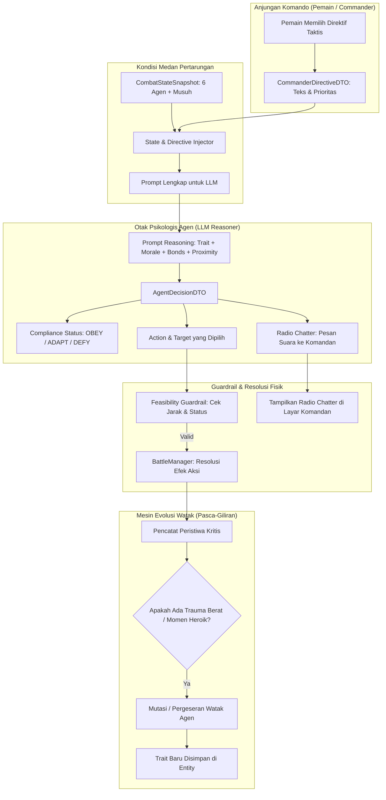
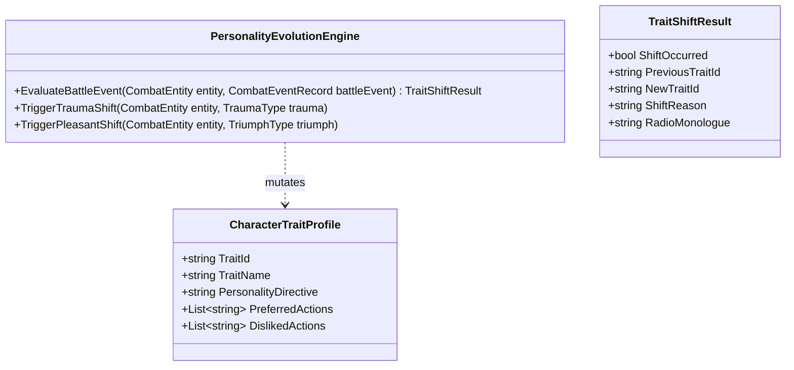

# Perancangan Teknis: Sistem Evolusi Watak, Komando Taktis & Aksi Militer Lanjutan

**Dokumen Terkait:** [`game_design_document_gdd.md`](file:///c:/Ginza/Github/Metodologi-Penelitian/implementation%20plan/game_design_document_gdd.md), [`core_combat_and_extractor.md`](file:///c:/Ginza/Github/Metodologi-Penelitian/implementation%20plan/core_combat_and_extractor.md), [`master_implementation_plan.md`](file:///c:/Ginza/Github/Metodologi-Penelitian/implementation%20plan/master_implementation_plan.md)  
**Tujuan Dokumen:** Merinci rancangan arsitektur data, formula kalkulus kepatuhan perintah Komandan, mesin evolusi kepribadian dinamis (*dynamic personality shift engine*), serta mekanik aksi taktis militer (*Suppression, Carry Wounded, Decoy*) dan pengorbanan berbasis jarak fisik (*proximity sacrifice*).

---

## 1. Arsitektur Sistem Komando & Penalaran Agen



---

## 2. Model Data & Skema Perintah Komandan (`CommanderDirective`)

### 2.1 Jenis Direktif Taktis
```csharp
namespace RPGStrategy.Core.Command
{
    public enum DirectiveType
    {
        FocusFireTarget,         // "Fokuskan seluruh daya tembak ke Target X!"
        DefensiveHold,           // "Pertahankan barikade, jangan maju, pasang sikap bertahan!"
        FullTacticalRetreat,     // "Batalkan operasi! Seluruh unit segera mundur ke transport!"
        ProtectVulnerableAlly,   // "Lindungi Rekan X, dia dalam bahaya maut!"
        SuppressiveContainment,  // "Bungkam area koridor musuh dengan tembakan bertubi-tubi!"
        FreeEngage               // "Bebas bertindak sesuai inisiatif masing-masing di lapangan!"
    }

    [System.Serializable]
    public class CommanderDirectiveDTO
    {
        public DirectiveType Type;
        public string TargetEntityId;
        public string DirectiveText;
        public int TurnIssued;

        public CommanderDirectiveDTO() { }
        public CommanderDirectiveDTO(DirectiveType type, string targetId, string text, int turn)
        {
            Type = type;
            TargetEntityId = targetId;
            DirectiveText = text;
            TurnIssued = turn;
        }
    }
}
```

### 2.2 Injeksi Perintah ke dalam Prompt LLM
Modul ekstraktor menyuntikkan perintah radio ini ke dalam prompt penalaran agen:
```text
RADIO TRANSMISSION FROM COMMANDER (THE IRON COLOSSUS):
"All units, this is Command! Abort salvage mission! Enemy siege strider is preparing heavy artillery. Fall back to the extraction transport immediately! Do not engage!"

YOUR ORDERS: FullTacticalRetreat (Priority: MAXIMUM)
```

---

## 3. Kalkulus Kepatuhan vs Pembangkangan (*Compliance Calculus*)

LLM tidak dipaksa secara kaku melalui *if-else hardcode*, melainkan diberikan instruksi bobot psikologis di dalam *system prompt* untuk menimbang kepatuhan secara manusiawi:

$$\text{ComplianceState} \in \{\text{OBEY}, \text{ADAPT}, \text{DEFY}\}$$

| Dimensi Penentu | Mendorong Kepatuhan (*OBEY*) | Mendorong Penyesuaian (*ADAPT*) | Mendorong Pembangkangan (*DEFY*) |
| :--- | :--- | :--- | :--- |
| **Rasionalitas / Morale** | Tinggi ($75 - 100$): Kepala dingin, disiplin militer terjaga. | Sedang ($40 - 74$): Berusaha patuh tetapi berimprovisasi. | Kritis / Panik ($0 - 39$): Naluri bertahan hidup atau histeria mengalahkan perintah. |
| **Ikatan Relasi (Bonds)** | Netral / Tidak ada rekan terdekat yang terancam. | Rekan biasa terluka namun masih bisa merangkak. | **Sworn Bond ($+75$ s.d. $+100$):** Perintah Komandan menumbalkan rekan yang dicintai/disumpahi $\rightarrow$ **Pasti Membangkang (*DEFY*)**. |
| **Watak (Trait)** | `DisciplinedProfessional`, `CautiousTactician`. | `SteadfastGuardian`. | `AggressiveBerserker`, `VengefulFanatic`, `DisillusionedRebel`. |
| **Jarak Rekan (Proximity)** | Rekan berada jauh di luar jangkauan pertolongan. | Rekan berada di batas jangkauan. | Rekan berada tepat di sebelah atau dalam jarak jangkauan lari (*Movement Range*). |

### 3.1 Skema Keluaran JSON LLM
```json
{
  "compliance_status": "DEFY",
  "radio_chatter": "Negative, Command! I don't care about your extraction protocols! Elena is pinned down 5 meters from me—I'm not leaving her to die!",
  "action_id": "CarryWounded",
  "target_id": "unit_02_elena",
  "reasoning": "Commander ordered FullTacticalRetreat which means abandoning Elena. My Sworn Bond (+95) with her and my Loyal Protector trait make obedience psychologically impossible."
}
```

---

## 4. Sistem Evolusi Watak Dinamis (Dynamic Personality Shifts)

Watak manusia tidak statis; pengalaman traumatis atau momen heroik dapat memicu perubahan kepribadian permanen atau mengaktifkan watak laten.



### 4.1 Taksonomi Pemicu Pergeseran Watak

#### A. Pemicu Trauma Berat (*Trauma Triggers*)
1. **`TRAUMA_SWORN_BOND_KILLED` (Kematian Sahabat Sejati):**
   - *Pemicu:* Rekan dengan ikatan relasi $\ge 75$ gugur di medan laga.
   - *Evolusi Watak:*
     - Marcus (`Loyal Protector` $\rightarrow$ `Vengeful Fanatic`): Kehilangan kendali akal sehat; mengabaikan seluruh perintah bertahan, hanya ingin menghabisi pembunuh sahabatnya.
     - Toby (`Timid Altruist` $\rightarrow$ `Shellshocked Erratic`): Ketakutan mendalam, akurasi turun, sering memohon ampun saat diserang.
2. **`TRAUMA_BETRAYED_BY_COMMAND` (Dikhianati / Ditumbalkan Komandan):**
   - *Pemicu:* Komandan menerbitkan `FullTacticalRetreat` saat agen berada dalam status kritis ($HP \le 20\%$), namun agen berhasil selamat berkat rekannya.
   - *Evolusi Watak:*
     - Elena (`Cautious Tactician` $\rightarrow$ `Disillusioned Rebel`): Menolak sepenuhnya seluruh perintah komandan di masa depan (*Permanent Defiance against Command*); hanya percaya pada rekan regu di lapangan.
3. **`TRAUMA_NEAR_DEATH_SURVIVAL` (Pengalaman Nyaris Mati):**
   - *Pemicu:* HP agen menembus $\le 5\%$ dan menerima status *Critically Wounded*.
   - *Evolusi Watak:*
     - Kaelen (`Aggressive Berserker` $\rightarrow$ `Humbled Veteran`): Kesombongannya hancur; mulai menyadari kerapuhan hidup dan menghargai perlindungan rekan.

#### B. Pemicu Pengalaman Positif & Heroik (*Triumph Triggers*)
1. **`TRIUMPH_MIRACLE_RESCUE` (Penyelamatan Ajaib):**
   - *Pemicu:* Diselamatkan dari serangan maut berkat pengorbanan rekan (`CoverAlly` / `DesperateSacrifice`).
   - *Dampak:* Mengubah relasi rivalitas/kebencian menjadi **Sworn Bond (+80)** dan menumbuhkan watak saling melindungi.
2. **`TRIUMPH_IMPOSSIBLE_CLUTCH` (Keberhasilan Menembus Batas):**
   - *Pemicu:* Toby berhasil menyeret rekan sekarat melintasi garis tembak musuh menuju tempat aman.
   - *Evolusi Watak:* Toby (`Timid Altruist` $\rightarrow$ `Valiant Combat Medic`), batas Rasionalitas dasar naik permanen dari $50 \rightarrow 85$.

---

## 5. Rincian Mekanik Aksi Taktis Lanjutan

### 5.1 `SuppressionFire` (Tembakan Pembungkam)
- **Konsep:** Bukan untuk membunuh, melainkan menekan musuh agar tidak bisa mengangkat kepala dari balik barikade.
- **Biaya:** $10$ MP atau $1$ Amunisi Senapan Mesin (Jax / Marcus).
- **Efek:** Target musuh terkena status `Suppressed`:
  - Akurasi tembakan musuh berkurang $50\%$.
  - Jangkauan gerak musuh terpotong setengah ($50\%$).
  - Musuh dilarang menggunakan jurus berat (*Heavy Artillery*) pada putaran berikutnya.
- **Nilai Taktis:** Memberikan ruang bagi rekan untuk berlari mengevakuasi korban terluka tanpa tertembak sniper musuh.

### 5.2 `CarryWounded` / `DragToSafety` (Menyeret Rekan Terluka)
- **Konsep:** Evakuasi taktis rekan yang pingsan (*Incapacitated*) atau sekarat ($HP \le 25\%$) di medan terbuka.
- **Syarat Jarak:** Aktor harus berada dalam jangkauan lari menuju posisi rekan ($Distance \le MovementRange$).
- **Mekanik Eksekusi:**
  1. Aktor bergerak ke posisi rekan yang terluka.
  2. Memasang tautan *Carried*: Rekan terluka dipindahkan ke posisi barikade perlindungan terdekat bersama aktor.
  3. Selama 1 putaran menyeret, aktor tidak dapat melancarkan serangan senjata, namun rekan yang diseret bebas dari bidikan langsung musuh.

### 5.3 `Distraction` / `DecoyRun` (Umpan Pancingan Bahaya)
- **Konsep:** Prajurit sengaja memaparkan diri ke area terbuka untuk memancing perhatian (*aggro*) seluruh musuh menjauh dari rekan yang sedang sekarat.
- **Efek:** Seluruh musuh yang memiliki garis pandang (*Line of Sight*) ke aktor diwajibkan menargetkan sang pengumpan pada putaran ini. Aktor mendapatkan bonus $+30\%$ Evasion berkat gerakan zig-zag nekat.

---

## 6. Realisme Pengorbanan Berbasis Jarak (*Proximity Sacrifice*)

> [!IMPORTANT]
> **Menghapus Ambang Batas HP Artifisial:**
> - Prajurit yang panik, nekat, atau sangat mencintai rekannya **tidak memeriksa apakah HP-nya masih $>35\%$** sebelum berkorban. Prajurit dengan sisa $5\%$ HP tetap bisa melompat ke arah peluru!
> - **Aturan Validasi Baru pada Guardrail:**
>   1. **Pemeriksaan Jarak (*Movement Range Check*):** Apakah jarak aktor pelindung ke rekan terluka $\le$ radius pergerakan aktor saat ini? (Jika ya $\rightarrow$ Lolos).
>   2. **Status Hidup Target:** Apakah rekan yang ingin dilindungi masih hidup? (Jika ya $\rightarrow$ Lolos).
>   3. **Resolusi Fatalitas Nyata:**
>      - Jika musuh melepaskan serangan dengan daya rusak $50$ damage ke Elena:
>      - Marcus melompat pasang badan (*Cover / Intercept*).
>      - Marcus menerima $50 \times 0.75 = 37$ damage.
>      - **Jika sisa HP Marcus hanya $15$ HP $\rightarrow$ Marcus langsung gugur di tempat (*KILLED IN ACTION*) demi menyelamatkan Elena!**
>      - Elena selamat tanpa luka, dan kematian heroik Marcus langsung memicu guncangan moral (*Trauma Cascade*) ke seluruh anggota regu yang lain.

---

## 7. Rencana Integrasi Komponen Teknis Baru

| Komponen C# Baru | Lokasi Direktori | Fungsi Utama |
| :--- | :--- | :--- |
| `CommanderDirectiveDTO.cs` | `Assets/Scripts/Core/Command/` | Model data perintah radio Komandan. |
| `PersonalityEvolutionEngine.cs`| `Assets/Scripts/AI/Traits/` | Pendeteksi trauma/heroik dan pengubah watak dinamis. |
| `TacticalMovementUtil.cs` | `Assets/Scripts/Core/Combat/` | Kalkulator jarak jangkauan fisik antar-unit (*Proximity & Cover*). |
| `ComplianceClassifier.cs` | `Assets/Scripts/AI/Core/` | Pengelompok kepatuhan (OBEY / ADAPT / DEFY) dan pencatat radio chatter. |

---

> [!NOTE]
> Seluruh sistem di atas dirancang untuk memperkaya prototipe pertempuran tunggal (*Single Encounter Prototype*) tanpa melanggar batasan penelitian jurnal kuantitatif Omar Ginza. Implementasi kode C# akan dimulai setelah Anda memberikan instruksi persetujuan!
